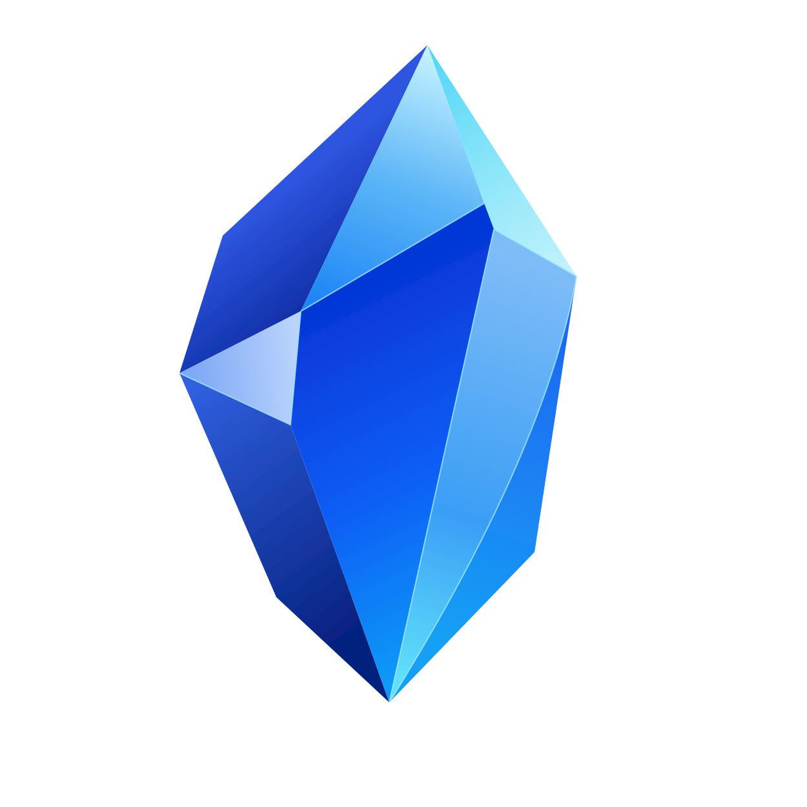

<p align="center">
  
</p>

<h1 align="center">Quarz</h1>

<p align="center">
  Ein schneller Open-Source-Markdown-Editor für deine Notizen. Lokal, ohne Abo.
</p>

<p align="center">
  <a href="README.md">🇬🇧 English</a> · 🇩🇪 Deutsch
</p>

---

> **Status:** frühe Entwicklung (v0.1.0). Für den Schreiballtag funktioniert Quarz schon, aber viele Funktionen fehlen noch und es wird sich einiges ändern. Releases gibt es noch keine.

## Was ist Quarz?

Quarz ist eine Desktop-App zum Schreiben und Ordnen von Notizen in reinen Markdown-Dateien, im Stil von [Obsidian](https://obsidian.md). Deine Notizen sind ganz normale `.md`-Dateien in einem ganz normalen Ordner (einem **Vault**). Quarz sperrt sie nicht in eine Datenbank oder ein eigenes Format: Du kannst sie mit jedem anderen Programm öffnen, bearbeiten, sichern oder versionieren.

Gebaut ist es mit **Tauri 2** und **Rust** im Backend und **SolidJS** mit **CodeMirror 6** in der Oberfläche. Dadurch bleibt es klein und schnell.

## Warum ich es angefangen habe

Ich mag Obsidian. Aber ein paar Dinge stören mich genug, um mir einen eigenen Editor zu bauen:

- **Synchronisation ist umständlich und kostet Geld.** Notizen zwischen Geräten aktuell zu halten heißt entweder, für Obsidian Sync zu zahlen, oder selbst Git, Dropbox oder Ähnliches einzurichten, mit allen Konflikten, die dazugehören. Die eigenen Textdateien zu synchronisieren sollte kein Abo brauchen.
- **Obsidian ist nicht Open Source.** Ich will einen Editor, dessen Code jeder lesen, reparieren und anpassen kann.
- **Electron ist schwer.** Tauri nutzt die Webview des Systems und ein Rust-Backend. Die App wird dadurch viel kleiner und braucht weniger Arbeitsspeicher.
- **Ich will einen Editor, der genau so funktioniert, wie ich es mag.** Wenn ich ihn selbst baue, kann jedes Detail so sein, wie ich es will.
- **Und ich wollte lernen:** Rust, Tauri und SolidJS an einem echten Projekt statt an Spielbeispielen.

## Ziele

- **Deine Dateien bleiben deine.** Reines Markdown in normalen Ordnern, lesbar auch ohne Quarz.
- **Einfache, kostenlose Synchronisation** zwischen deinen Geräten, ohne Abo. *(geplant, der Hauptgrund für dieses Projekt)*
- **Schnell und leicht**, auch bei großen Vaults.
- **Open Source**, damit jeder es verstehen und erweitern kann.

## Funktionen

Was heute schon geht:

- **Vaults:** Jeden Ordner als Vault öffnen. Quarz merkt sich den letzten und öffnet ihn beim nächsten Start wieder. Beim ersten Start erscheint eine Vault-Auswahl.
- **Live-Vorschau:** Markdown wird beim Tippen gerendert, an der Cursorposition taucht die rohe Syntax wieder auf. Codeblöcke mit Syntax-Highlighting und Kopier-Button, Formeln mit KaTeX.
- **Tabs:** Vorschau-Tabs wie in VS Code (ein einfacher Klick ersetzt den Vorschau-Tab, Bearbeiten pinnt ihn). Offene Tabs und die fokussierte Notiz werden pro Vault wiederhergestellt.
- **Seitenleiste:** Ordnerbaum, Notizen und Ordner anlegen.
- **Autosave:** Notizen werden 500 ms nach dem letzten Tastendruck gespeichert. Das Schreiben ist atomar, ein Absturz hinterlässt also nie eine halb geschriebene Datei.
- **Umbenennen** einer Notiz über ihren Titel über dem Editor.
- **Tastenkürzel:**

  | Kürzel | Aktion |
  |---|---|
  | `Strg/Cmd + S` | Notiz speichern |
  | `Strg/Cmd + N` | neue Notiz |
  | `Strg/Cmd + W` | Tab schließen |
  | `Strg + Tab` / `Strg + Umschalt + Tab` | nächster / vorheriger Tab |
  | `↑` in der ersten Zeile | in den Titel springen |

## Roadmap

Ideen, keine Versprechen:

- [ ] Synchronisation zwischen Geräten ohne Abo
- [ ] Notizen löschen, Ordner umbenennen und verschieben
- [ ] Änderungen von außerhalb der App bemerken, während ein Vault offen ist
- [ ] Suche über alle Notizen
- [ ] Links zwischen Notizen

## Loslegen

### Voraussetzungen

- [Node.js](https://nodejs.org) (mit npm)
- [Rust](https://www.rust-lang.org/tools/install) (stable)
- Die [Tauri-Voraussetzungen](https://tauri.app/start/prerequisites/) für dein Betriebssystem

### Im Entwicklungsmodus starten

```bash
git clone https://github.com/Kelchninja/quarz-editor.git
cd quarz-editor
npm install
npm run tauri dev
```

In einem Debug-Build erzeugt jeder Start auch die TypeScript-Bindings in `src/bindings.ts` aus den Rust-Commands neu.

### Bauen

```bash
npm run tauri build
```

Der Installer landet in `src-tauri/target/release/bundle/`.

## Projektstruktur

```
quarz-editor/
├── src/             Frontend: SolidJS-Komponenten, Editor-Setup, State
│   ├── components/  Sidebar, TabBar, Editor, VaultPicker, …
│   ├── editor/      CodeMirror-Erweiterungen: Tastenkürzel, Autosave, Theme
│   ├── state/       Vault-Store und Tabs
│   └── bindings.ts  aus den Rust-Commands generiert, nicht von Hand ändern
├── src-tauri/       Backend: Rust + Tauri
│   └── src/         Commands, Vault-Index, Registry, Logging
└── docs/            Dokumentation
```

## Dokumentation

- **Backend:** [Deutsch](docs/backend/de/README.md) · [English](docs/backend/en/README.md). Architektur, Start, alle Commands, Dateiformate und Fehlerbehandlung, mit Diagrammen.

## Wo Quarz Daten ablegt

| Was | Wo |
|---|---|
| Deine Notizen | in deinem Vault-Ordner, als `.md`-Dateien |
| Offene Tabs eines Vaults | `<Vault>/.quarz/state.json` |
| Bekannte Vaults, zuletzt geöffneter | `registry.json` im App-Datenordner (`%LOCALAPPDATA%\com.kelchninja.quarz` unter Windows) |
| Logdatei | `logs/quarz-editor.log` im selben Ordner |

Details unter [Persistenz](docs/backend/de/persistenz.md).

## Gebaut mit

[Tauri](https://tauri.app) · [Rust](https://www.rust-lang.org) · [SolidJS](https://www.solidjs.com) · [CodeMirror 6](https://codemirror.net) · [codemirror-live-markdown](https://github.com/Kelchninja/codemirror-live-markdown) · [KaTeX](https://katex.org) · [Lucide](https://lucide.dev) · [tauri-specta](https://github.com/specta-rs/tauri-specta)

## Lizenz

[MIT](https://opensource.org/licenses/MIT)
