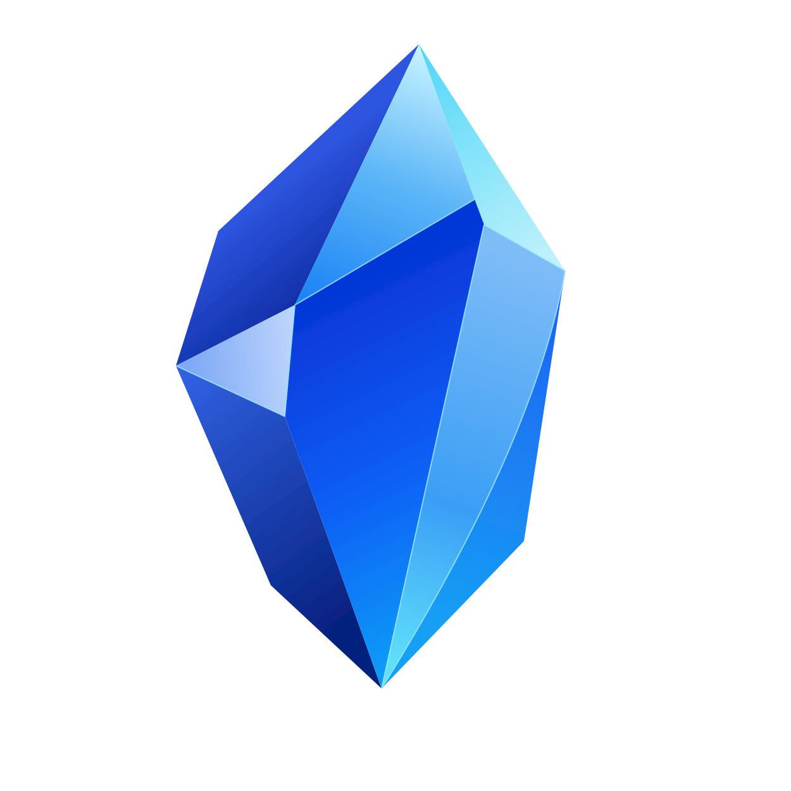

<p align="center">
  
</p>

<h1 align="center">Quarz</h1>

<p align="center">
  A fast, open source Markdown editor for your notes. Local first, no subscription.
</p>

<p align="center">
  🇬🇧 English · <a href="README.de.md">🇩🇪 Deutsch</a>
</p>

---

> **Status:** early development (v0.1.0). Quarz works for everyday writing, but many features are still missing and things will change. There are no releases yet.

## What is Quarz?

Quarz is a desktop app for writing and organizing notes in plain Markdown files, in the spirit of [Obsidian](https://obsidian.md). Your notes are ordinary `.md` files in an ordinary folder (a **vault**). Quarz doesn't lock them into a database or a proprietary format: you can open, edit, back up or version them with any other tool.

It is built with **Tauri 2** and **Rust** for the backend and **SolidJS** with **CodeMirror 6** for the interface, so it stays small and fast.

## Why I started it

I like Obsidian. But a few things bother me enough that I wanted to build my own:

- **Sync is clumsy and costs money.** Keeping notes in sync between devices either means paying for Obsidian Sync or wiring up Git, Dropbox or similar yourself, with all the conflicts that come with it. Syncing your own text files shouldn't need a subscription.
- **Obsidian is not open source.** I want an editor whose code anyone can read, fix and adapt.
- **Electron is heavy.** Tauri uses the system's webview and a Rust backend, which makes the app much smaller and lighter on memory.
- **I want an editor that works exactly the way I like.** Building it myself means every detail can be the way I want it.
- **And I wanted to learn** Rust, Tauri and SolidJS on a real project instead of toy examples.

## Goals

- **Your files stay yours.** Plain Markdown in plain folders, readable without Quarz.
- **Simple, free sync** between your devices, without a subscription. *(planned, the main reason this project exists)*
- **Fast and lightweight**, even with large vaults.
- **Open source**, so anyone can understand and extend it.

## Features

What works today:

- **Vaults:** open any folder as a vault. Quarz remembers the last one and opens it on the next start. On the first start a vault picker appears.
- **Live preview:** Markdown is rendered while you type, and the raw syntax shows up again where the cursor is. Code blocks with syntax highlighting and a copy button, math with KaTeX.
- **Tabs:** preview tabs like in VS Code (a single click replaces the preview tab, editing pins it). Open tabs and the focused note are restored per vault.
- **Sidebar:** folder tree, create notes and folders.
- **Autosave:** notes are saved 500 ms after you stop typing, written atomically so a crash never leaves a half-written file.
- **Rename** a note by editing its title above the editor.
- **Keyboard shortcuts:**

  | Shortcut | Action |
  |---|---|
  | `Ctrl/Cmd + S` | save note |
  | `Ctrl/Cmd + N` | new note |
  | `Ctrl/Cmd + W` | close tab |
  | `Ctrl + Tab` / `Ctrl + Shift + Tab` | next / previous tab |
  | `↑` in the first line | jump into the title |

## Roadmap

Ideas, not promises:

- [ ] Sync between devices without a subscription
- [ ] Delete notes, rename and move folders
- [ ] Notice changes made outside the app while a vault is open
- [ ] Search across all notes
- [ ] Links between notes

## Getting started

### Requirements

- [Node.js](https://nodejs.org) (with npm)
- [Rust](https://www.rust-lang.org/tools/install) (stable)
- The [Tauri prerequisites](https://tauri.app/start/prerequisites/) for your operating system

### Run in development

```bash
git clone https://github.com/Kelchninja/quarz-editor.git
cd quarz-editor
npm install
npm run tauri dev
```

In a debug build, starting the app also regenerates the TypeScript bindings in `src/bindings.ts` from the Rust commands.

### Build

```bash
npm run tauri build
```

The installer ends up in `src-tauri/target/release/bundle/`.

## Project structure

```
quarz-editor/
├── src/             frontend: SolidJS components, editor setup, state
│   ├── components/  Sidebar, TabBar, Editor, VaultPicker, …
│   ├── editor/      CodeMirror extensions: keybindings, autosave, theme
│   ├── state/       vault store and tabs
│   └── bindings.ts  generated from the Rust commands, don't edit by hand
├── src-tauri/       backend: Rust + Tauri
│   └── src/         commands, vault index, registry, logging
└── docs/            documentation
```

## Documentation

- **Backend:** [English](docs/backend/en/README.md) · [Deutsch](docs/backend/de/README.md). Architecture, startup, all commands, file formats and error handling, with diagrams.

## Where Quarz stores data

| What | Where |
|---|---|
| Your notes | in your vault folder, as `.md` files |
| Open tabs of a vault | `<vault>/.quarz/state.json` |
| Known vaults, last opened | `registry.json` in the app data folder (`%LOCALAPPDATA%\com.kelchninja.quarz` on Windows) |
| Log file | `logs/quarz-editor.log` in the same folder |

Details in [Persistence](docs/backend/en/persistence.md).

## Built with

[Tauri](https://tauri.app) · [Rust](https://www.rust-lang.org) · [SolidJS](https://www.solidjs.com) · [CodeMirror 6](https://codemirror.net) · [codemirror-live-markdown](https://github.com/Kelchninja/codemirror-live-markdown) · [KaTeX](https://katex.org) · [Lucide](https://lucide.dev) · [tauri-specta](https://github.com/specta-rs/tauri-specta)

## License

[MIT](https://opensource.org/licenses/MIT)
