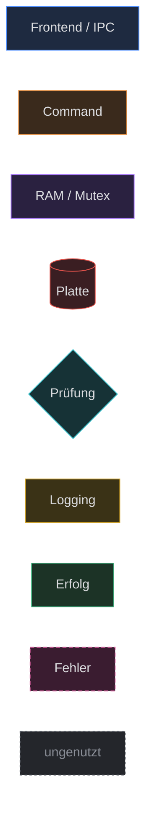
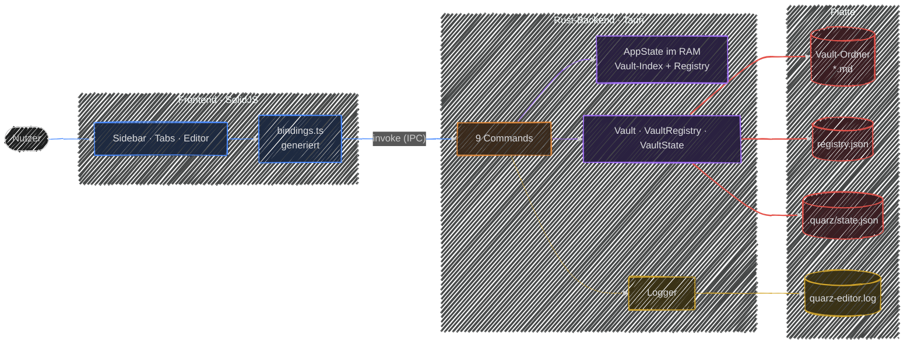
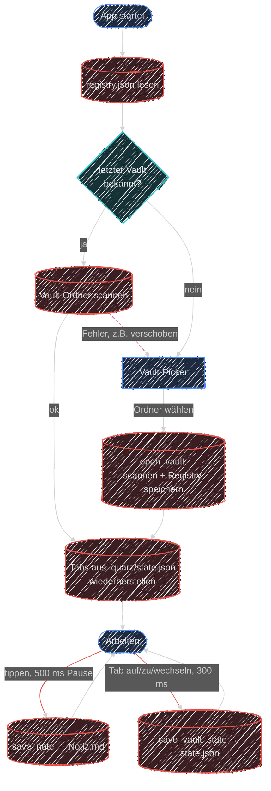
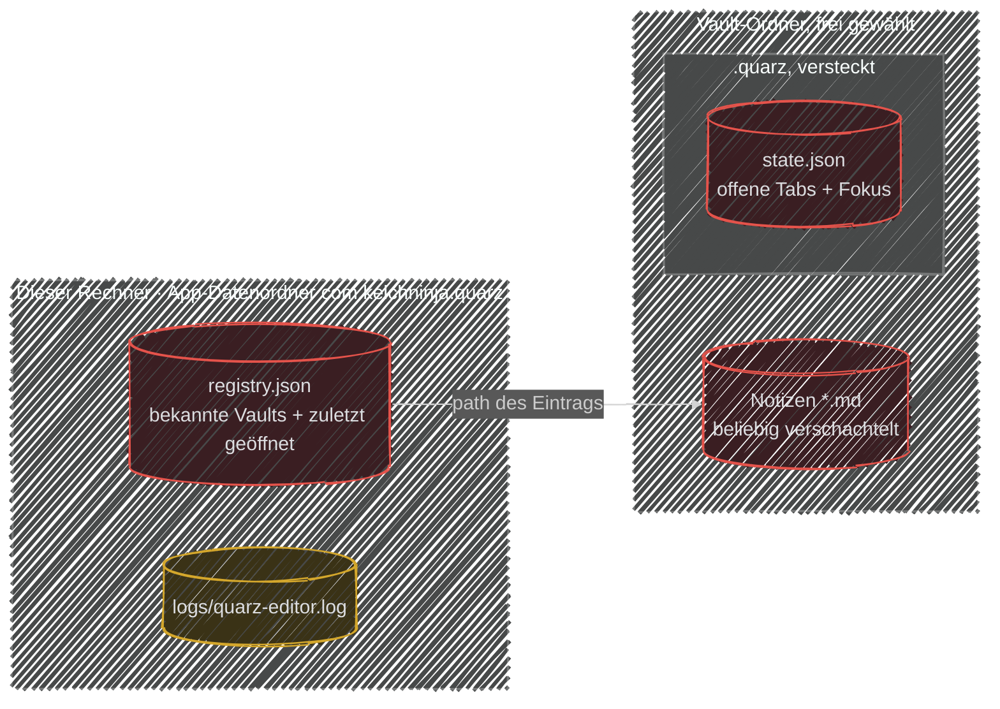

# Quarz – Rust-Backend

🇩🇪 Deutsch · [🇬🇧 English](../en/README.md)

Dokumentation des Backends in `src-tauri/` (Tauri 2, Rust 2024).
Stand: Version 0.1.0, November 2026.

Das Backend kann:

- einen **Vault** (Ordner mit Markdown-Notizen) öffnen und im RAM indizieren,
- Notizen **lesen, anlegen, speichern, umbenennen** und Ordner anlegen,
- sich merken, **welcher Vault zuletzt offen war** (`registry.json`),
- pro Vault die **offenen Tabs** speichern (`.quarz/state.json`),
- Fehler in eine **Logdatei** schreiben.

Das Frontend (SolidJS) spricht ausschließlich über **Tauri-Commands** mit dem Backend.

## Inhalt

| Seite | Worum es geht |
|---|---|
| [Architektur](architektur.md) | Schichten, Module, `AppState`, Datenmodell |
| [App-Start](start.md) | Was beim Start passiert, welcher Vault aufgeht |
| [Commands](commands.md) | Die IPC-Schnittstelle zum Frontend, alle 9 Commands |
| [Vault](vault.md) | Index im RAM, Scan, `VaultPath`, Dateioperationen |
| [Persistenz](persistenz.md) | Welche Dateien wo liegen und wie sie geschrieben werden |
| [Fehler und Logging](fehler-und-logging.md) | Fehlertypen und der Weg eines Fehlers bis ins Log |

Die PlantUML-Diagramme in [`docs/diagrams/`](../../diagrams/) zeigen einen früheren Stand.

## Farblegende

Alle Diagramme verwenden dieselben Farben:

| Farbe | Bedeutung |
|---|---|
| 🔵 Blau | Frontend, IPC-Aufrufe |
| 🟠 Orange | Commands, also der Einstieg ins Backend |
| 🟣 Lila | Zustand im RAM: `AppState`, Mutex, Vault-Index |
| 🔴 Rot | **Plattenzugriff** (`std::fs`) |
| 🩵 Türkis | Prüfung, Validierung, Entscheidung |
| 🟡 Gelb | Logging |
| 🟢 Grün | Erfolg |
| 🩷 Pink, gestrichelt | Fehlerpfad |
| ⚪ Grau, gestrichelt | ungenutzt oder ignoriert |



## Das Programm in Skizzen

### Skizze 1: Wer redet mit wem



### Skizze 2: Eine Sitzung von Start bis Arbeit



### Skizze 3: Wo die Daten liegen



## Modulübersicht

```
src-tauri/src/
├── main.rs              Einstieg, ruft lib::run() auf
├── lib.rs               Tauri-Builder: Plugins, setup(), Commands, Bindings-Export
├── app.rs               AppState: Mutex<Option<Vault>> + Mutex<VaultRegistry>
├── commands/
│   ├── vault.rs         alle 9 Tauri-Commands
│   └── helper.rs        with_vault / with_registry (Lock + Zugriff)
├── config/
│   ├── vaultregistry.rs VaultRegistry: registry.json laden/speichern
│   └── vaultentry.rs    VaultEntry: id, path, name
├── logging/
│   └── logging.rs       log_err: Fehler loggen und in String umwandeln
└── vault/
    ├── vault.rs         Vault: Index, Scan, Dateioperationen, VaultError
    ├── path.rs          VaultPath: geprüfter, relativer Pfad
    ├── meta.rs          VaultMeta / NoteMeta: Sicht fürs Frontend
    ├── vaultstate.rs    VaultState: .quarz/state.json
    ├── note.rs          ContentHash (+ ungenutzt: Note, NoteDocument)
    ├── entry.rs         ungenutzt: EntryMeta, Editable
    └── folder.rs        ungenutzt: Folder
```

## Abhängigkeiten

| Crate | Wofür |
|---|---|
| `tauri` 2 | App-Rahmen, Fenster, IPC, Pfade |
| `tauri-specta`, `specta`, `specta-typescript` | erzeugen `src/bindings.ts` aus den Commands und Typen |
| `serde`, `serde_json` | JSON für IPC, `registry.json`, `state.json` |
| `thiserror` | Fehler-Enums mit Meldungstext |
| `walkdir` | rekursiver Scan des Vault-Ordners |
| `blake3` | `ContentHash` einer Notiz |
| `uuid` | IDs der Vault-Einträge in der Registry |
| `log`, `tauri-plugin-log` | Logging ins Terminal und in eine Datei |
| `tauri-plugin-dialog` | Ordnerauswahl im Vault-Picker (vom Frontend genutzt) |
| `tauri-plugin-prevent-default` | unterdrückt Browser-Shortcuts im Webview |
| `tauri-plugin-opener` | **ungenutzt**, Rest aus dem Template |
