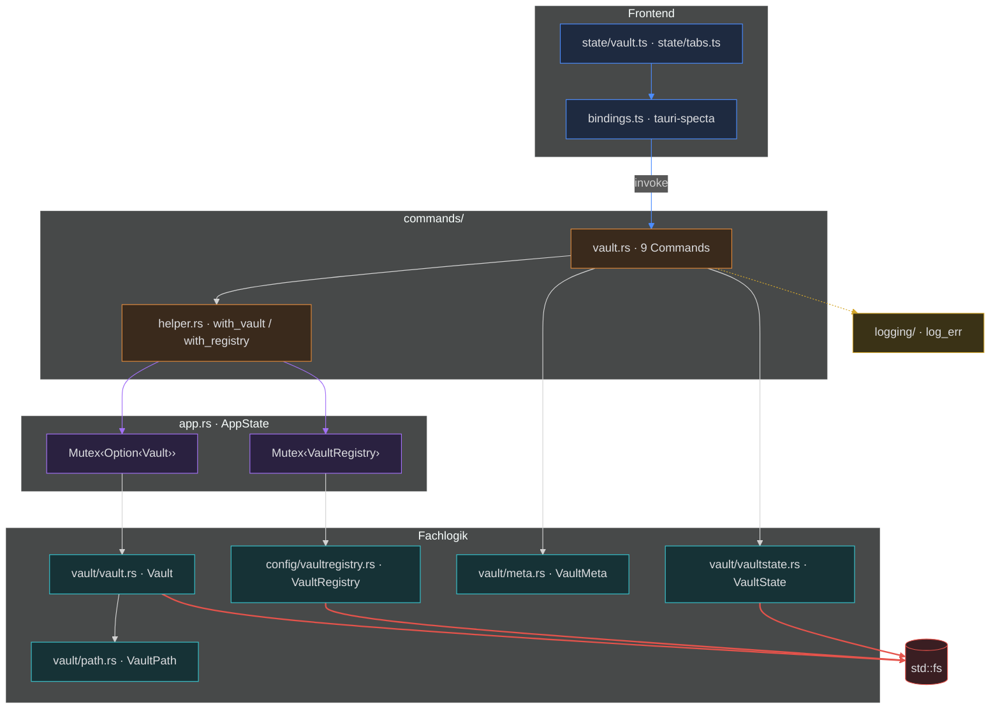
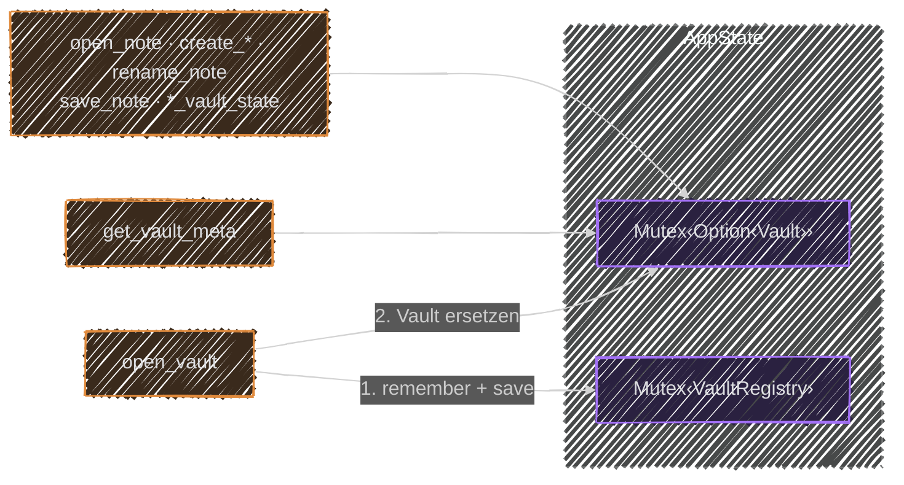
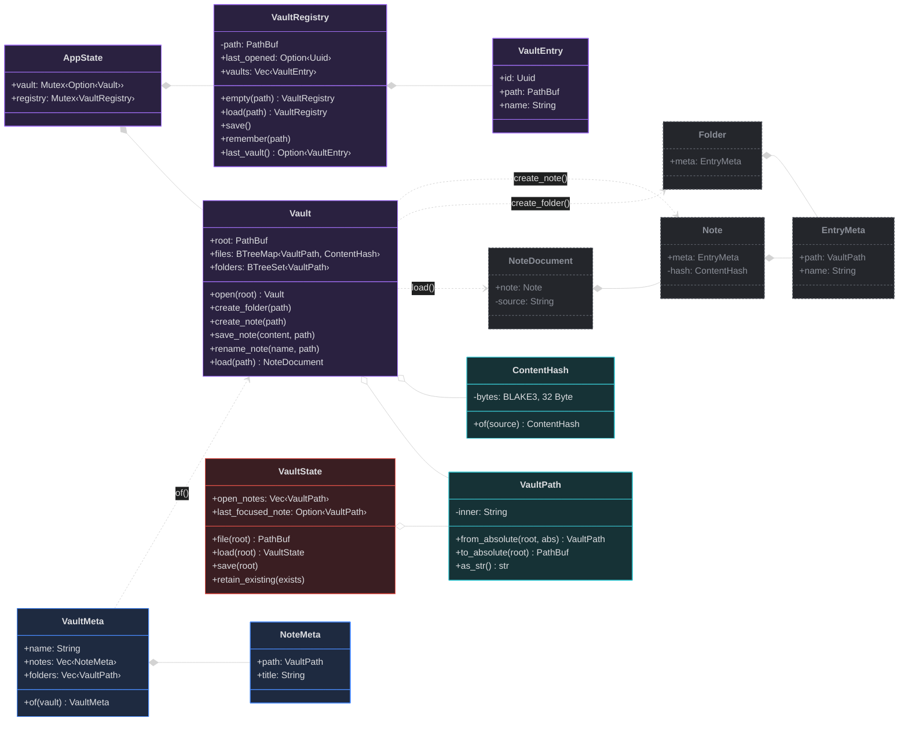

# Architektur

[← Übersicht](README.md)

## Schichten

Ein Aufruf aus dem Frontend geht immer denselben Weg: generierte Funktion in `bindings.ts` → Command → Helper mit Lock → Fachlogik → Dateisystem.



| Schicht | Aufgabe | Weiß nichts von |
|---|---|---|
| `commands/` | nimmt IPC-Aufrufe an, holt den Lock, wandelt Fehler in `String` um und loggt sie | Dateiformaten |
| `app.rs` | hält den gemeinsamen Zustand hinter Mutexen | Logik |
| `vault/`, `config/` | Fachlogik und Dateizugriffe | Tauri, IPC, Locks |
| `logging/` | `log_err`: Fehler loggen und als `String` weitergeben | – |

`Vault`, `VaultRegistry` und `VaultState` kennen Tauri nicht. Den Pfad zur Registry bestimmt nur `setup()` in `lib.rs`, danach merkt sich die Registry ihn selbst.

## AppState

```rust
pub struct AppState {
    pub vault: Mutex<Option<Vault>>,     // None = kein Vault offen → Picker
    pub registry: Mutex<VaultRegistry>,  // bekannte Vaults, zuletzt geöffnet
}
```

- Wird in `setup()` einmal mit `app.manage(...)` registriert. Commands bekommen ihn als `tauri::State<'_, AppState>`.
- `VaultState` liegt **nicht** im `AppState`. Er wird bei Bedarf direkt aus der Datei gelesen bzw. in sie geschrieben, die Wahrheit über offene Tabs liegt im Frontend.
- Kein Command hält beide Locks gleichzeitig. `open_vault` sperrt erst die Registry, gibt sie frei und sperrt dann den Vault. Deadlocks sind dadurch ausgeschlossen.



### Nebenläufigkeit

Alle Commands sind `async` und laufen auf dem Thread-Pool von Tauri. Der `std::sync::Mutex` wird für die **ganze** Operation gehalten, auch während des Plattenzugriffs. Commands auf denselben Vault laufen deshalb nacheinander, nie gleichzeitig. Bei der jetzigen Last (eine Speicherung alle paar hundert Millisekunden) ist das unkritisch.

Einzige Ausnahme: `open_vault` scannt den neuen Ordner **ohne** Lock. Erst danach wird der fertige `Vault` eingesetzt.

## Datenmodell

Grau gestrichelt: Typen, die existieren, aber nicht mehr benutzt werden.



### Was das Frontend sieht

Nur diese Typen gehen über die IPC-Grenze. `specta` erzeugt daraus TypeScript-Typen in `src/bindings.ts`:

| Rust | TypeScript | Hinweis |
|---|---|---|
| `VaultPath` | `string` | wird beim Empfang geprüft, siehe [Vault](vault.md#vaultpath) |
| `VaultMeta` | `{ name; notes: NoteMeta[]; folders: VaultPath[] }` | ganze Sicht auf den Vault, ohne Inhalte |
| `NoteMeta` | `{ path; title }` | `title` = Dateiname ohne `.md` |
| `VaultState` | `{ openNotes: VaultPath[]; lastFocusedNote: VaultPath \| null }` | camelCase per `serde(rename_all)` |
| `Result<T, String>` | `{ status: "ok", data: T } \| { status: "error", error: string }` | |

Die Sidebar baut ihren Baum selbst aus `notes` und `folders` (`buildTree.ts`). Das Backend liefert eine flache Liste.

## Ungenutzter Code

Liefert `cargo check` als Warnungen bzw. findet man per Suche:

| Was | Wo | Warum ungenutzt |
|---|---|---|
| `Note`, `NoteDocument`, `EntryMeta`, `Folder`, Trait `Editable` | `vault/note.rs`, `entry.rs`, `folder.rs` | Commands werfen die Rückgabewerte weg, von `NoteDocument` wird nur der Text gelesen |
| `ConfigDir`, `VaultNotFound`, `VaultAlreadyExists`, `InvalidVaultPath` | `config/vaultregistry.rs` | werden nie erzeugt |
| `tauri-plugin-opener` | `Cargo.toml`, `lib.rs`, Capabilities | Frontend importiert es nicht |
