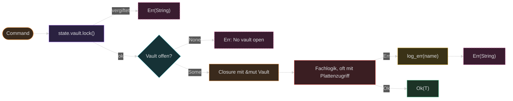
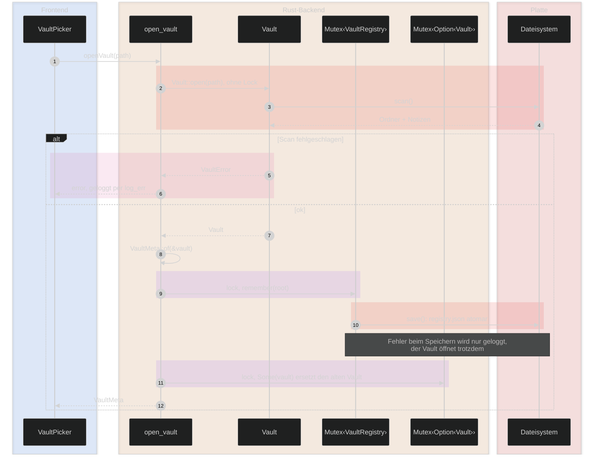
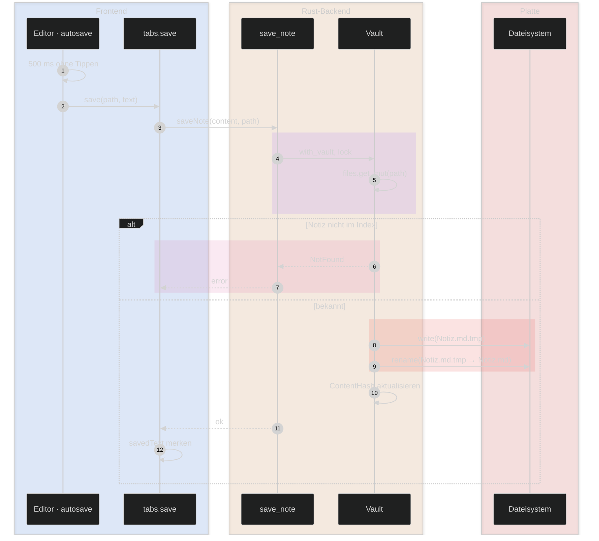
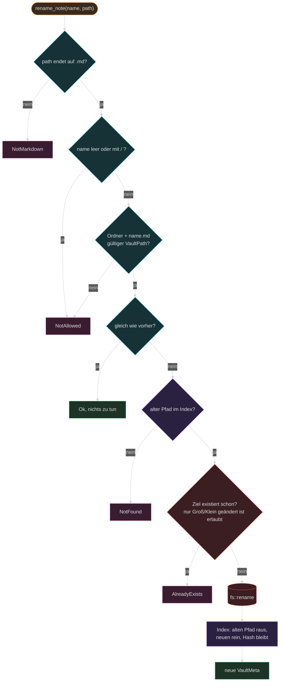
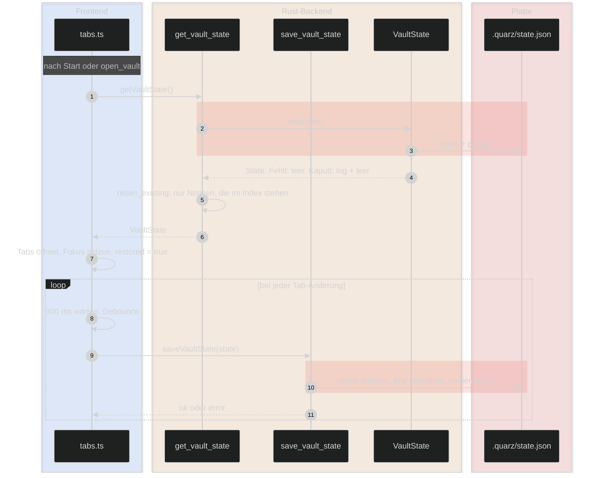

# Commands

[← Übersicht](README.md)

Commands sind die einzige Schnittstelle zwischen Frontend und Backend. Alle stehen in `commands/vault.rs`, registriert werden sie in `lib.rs` per `collect_commands!`. Das Frontend ruft sie über die generierten Funktionen in `src/bindings.ts` auf, zum Beispiel `commands.saveNote(text, path)`.

## Übersicht

| Command | Parameter | Rückgabe | Lock | Platte | Fehler geloggt |
|---|---|---|---|---|---|
| `open_vault` | `path: String` | `VaultMeta` | Registry, dann Vault | 🔴 scannt ganzen Ordner, schreibt `registry.json` | ja |
| `get_vault_meta` | – | `Option<VaultMeta>` | Vault | – | nein |
| `open_note` | `path: VaultPath` | `String` (Inhalt) | Vault | 🔴 liest `.md` | ja |
| `create_note` | `path: VaultPath` | `VaultMeta` | Vault | 🔴 legt leere Datei an | ja |
| `create_folder` | `path: VaultPath` | `VaultMeta` | Vault | 🔴 legt Ordner an | ja |
| `rename_note` | `name: String`, `path: VaultPath` | `VaultMeta` | Vault | 🔴 benennt Datei um | ja |
| `save_note` | `content: String`, `path: VaultPath` | `()` | Vault | 🔴 schreibt `.md` atomar | ja |
| `get_vault_state` | – | `VaultState` | Vault | 🔴 liest `.quarz/state.json` | kaputte Datei: ja |
| `save_vault_state` | `vault_state: VaultState` | `()` | Vault | 🔴 schreibt `.quarz/state.json` atomar | ja |

Alle Commands geben `Result<T, String>` zurück. Commands, die etwas am Vault ändern, liefern die neue `VaultMeta` mit, damit die Sidebar ohne zweiten Aufruf aktuell ist.

## Gemeinsames Muster

Fast jeder Command besteht aus `with_vault` plus einem Aufruf der Fachlogik plus `log_err`:

```rust
pub async fn create_note(path: VaultPath, state: tauri::State<'_, AppState>) -> Result<VaultMeta, String> {
    helper::with_vault(&state, |vault| {
        vault.create_note(path).map_err(log_err("create_note"))?;
        Ok(VaultMeta::of(vault))
    })
}
```



| Helfer | Datei | Macht |
|---|---|---|
| `with_vault(state, f)` | `commands/helper.rs` | sperrt `state.vault`, gibt `"No vault open"` zurück, wenn `None`, ruft sonst `f(&mut Vault)` auf |
| `with_registry(state, f)` | `commands/helper.rs` | sperrt `state.registry` und ruft `f(&mut VaultRegistry)` auf |
| `log_err(context)` | `logging/logging.rs` | Closure für `map_err`: loggt `"{context}: {e}"` als Fehler und gibt `e.to_string()` zurück |

### Geprüfte Parameter

Parameter vom Typ `VaultPath` werden **beim Deserialisieren** geprüft, bevor der Command überhaupt läuft. Ein Pfad wie `../../etc/passwd` kommt nie im Command an, das Frontend bekommt direkt einen Fehler. Details unter [Vault → VaultPath](vault.md#vaultpath).

## open_vault

Öffnet einen neuen Vault aus dem Picker und merkt ihn sich in der Registry.



## save_note (Autosave)

Das Frontend ruft `save_note` 500 ms nach dem letzten Tastendruck auf, getrennt pro Notiz.



`save_note` legt keine Notiz an. Eine Notiz, die nicht im Index steht, wird abgelehnt. Die `.md.tmp`-Datei endet nicht auf `.md` und wird deshalb vom Scan ignoriert, falls sie nach einem Absturz liegen bleibt.

## rename_note

Benennt nur Notizen um, und nur innerhalb ihres Ordners. `name` ist der neue Name **ohne** `.md`.



Die Prüfung „Ziel existiert schon“ ist nötig, weil `fs::rename` eine vorhandene Datei sonst still überschreibt. Die Ausnahme für Groß/Klein-Änderungen braucht Windows: Dort „existiert“ `notiz.md` schon, wenn man `Notiz.md` in `notiz.md` umbenennt.

## get_vault_state / save_vault_state

Merken sich die offenen Tabs pro Vault. Das Frontend ist die Wahrheit, das Backend liest und schreibt nur die Datei.



`retain_existing` entfernt Tabs von Notizen, die außerhalb der App gelöscht wurden. War die fokussierte Notiz darunter, bekommt der letzte verbleibende Tab den Fokus.

## get_vault_meta / open_note / create_note / create_folder

| Command | Ablauf |
|---|---|
| `get_vault_meta` | Lock, `VaultMeta::of(vault)` bzw. `None`, wenn kein Vault offen ist. Kein Plattenzugriff, das Frontend ruft es beim Start auf. |
| `open_note` | `fs::read_to_string` der Datei, gibt den Text zurück. Steht **nicht** im Index? Wird trotzdem gelesen, solange die Datei existiert. |
| `create_note` | Pfad muss auf `.md` enden, `File::create_new` (schlägt fehl, wenn es die Datei schon gibt), Hash des leeren Texts in den Index. Den freien Namen („Unbenannt 1.md“) sucht das Frontend aus. |
| `create_folder` | `fs::create_dir` (Elternordner muss existieren), Pfad in `folders`. |
