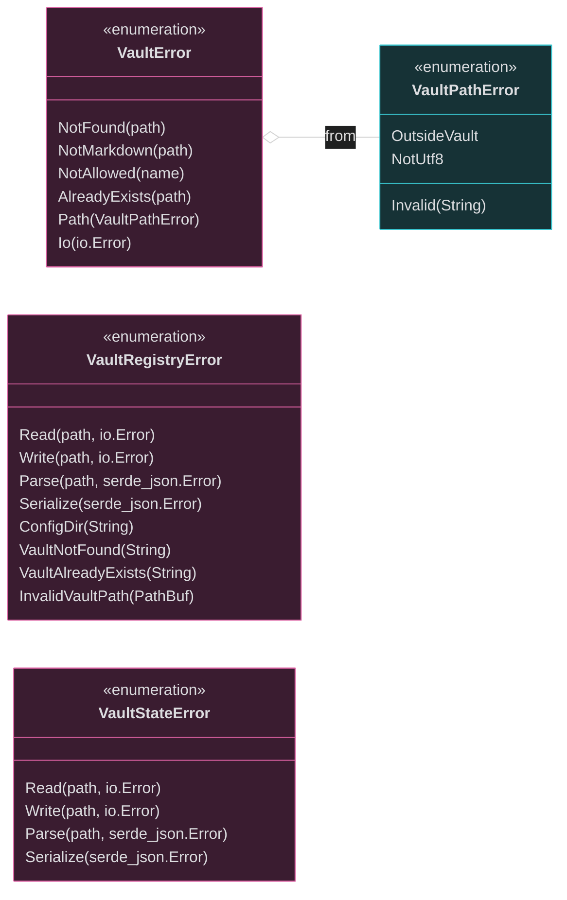
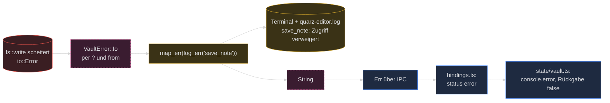
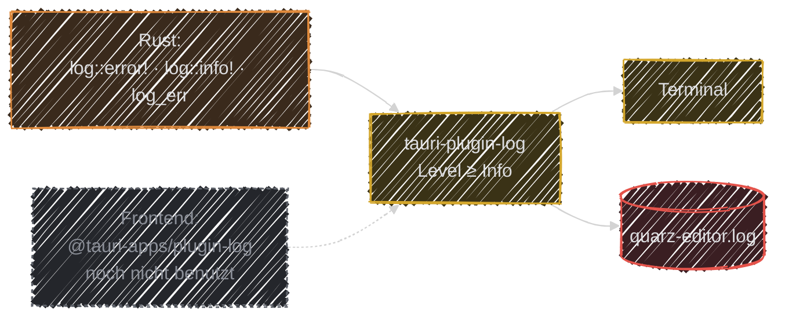

# Fehler und Logging

[← Übersicht](README.md)

## Fehlertypen

Jedes Modul hat ein eigenes Fehler-Enum mit `thiserror`. Über die IPC-Grenze geht immer nur ein `String`.



| Enum | Datei | Besonderheit |
|---|---|---|
| `VaultError` | `vault/vault.rs` | `Io` und `Path` per `#[from]`, deshalb reicht `?` |
| `VaultPathError` | `vault/path.rs` | entsteht beim Bauen eines `VaultPath`, auch beim Deserialisieren |
| `VaultRegistryError` | `config/vaultregistry.rs` | `Read`/`Write`/`Parse` mit Pfad, gesetzt per `map_err`. Die letzten vier Varianten sind ungenutzt |
| `VaultStateError` | `vault/vaultstate.rs` | gleich aufgebaut wie `VaultRegistryError` |

`Read` und `Write` haben denselben Quelltyp (`io::Error`). Deshalb wird mit `map_err` ausgewählt statt mit `#[from]`: `#[from]` könnte pro Quelltyp nur auf eine Variante zeigen.

## Weg eines Fehlers

Beispiel: `save_note` scheitert, weil die Datei schreibgeschützt ist.



`log_err` ist eine kleine Fabrik für `map_err`-Closures:

```rust
pub fn log_err<E: std::fmt::Display>(context: &str) -> impl FnOnce(E) -> String + '_ {
    move |e| {
        log::error!("{context}: {e}");
        e.to_string()
    }
}
```

Damit wird jeder Fehler **genau einmal** geloggt, nämlich in Rust, wo der echte Fehler mit Pfad bekannt ist. Das `console.error` im Frontend erscheint nur in den DevTools.

## Wo Fehler behandelt werden

| Stelle | Fehler | Reaktion |
|---|---|---|
| `setup`: `app_local_data_dir()` | Pfad nicht bestimmbar | `?`, App startet nicht |
| `setup`: `VaultRegistry::load` | Datei kaputt oder unlesbar | `log::error!`, leere Registry |
| `setup`: `Vault::open` | letzter Vault fehlt oder ist unlesbar | `log::error!`, `vault = None` → Picker |
| `open_vault`: `registry.save()` | Registry nicht schreibbar | `log::error!`, Vault öffnet trotzdem |
| `get_vault_state`: `VaultState::load` | `state.json` kaputt | `log::error!`, leerer State |
| alle Commands: Fachlogik | `VaultError`, `VaultStateError` | `log_err`, Fehler ans Frontend |
| alle Commands: `lock()` | Mutex vergiftet (Panic in einem anderen Command) | `to_string`, **nicht** geloggt |
| `with_vault` | kein Vault offen | `"No vault open"`, nicht geloggt |
| Deserialisieren eines `VaultPath` | ungültiger Pfad | Tauri lehnt den Aufruf ab, der Command läuft nicht |

Grundsatz: Kann die App sinnvoll weitermachen, wird geloggt und ein Ersatzwert benutzt. Die App soll nie wegen einer kaputten Hilfsdatei unbenutzbar werden.

## Logging

Eingerichtet in `lib.rs` mit `tauri-plugin-log`:

```rust
tauri_plugin_log::Builder::new()
    .targets([
        Target::new(TargetKind::Stdout),                     // Terminal von tauri dev
        Target::new(TargetKind::LogDir { file_name: None }), // Datei, Name = productName
    ])
    .level(log::LevelFilter::Info)
    .build()
```



| Eigenschaft | Wert |
|---|---|
| Level | `Info` und höher. `debug!`/`trace!` werden verworfen |
| Ziele | Terminal (nur sichtbar bei `tauri dev`) und Datei, Pfade unter [Persistenz → Pfade](persistenz.md#pfade) |
| Rotation | keine, die Datei wächst unbegrenzt |
| Frontend | Permission `log:default` und das npm-Paket sind da, das Frontend nutzt noch `console.error` |
| Panics | werden nicht geloggt. Im Release-Build gilt `panic = "abort"`, die App beendet sich dann ohne Eintrag |

Notizinhalte gehören nie ins Log, nur Pfade.
