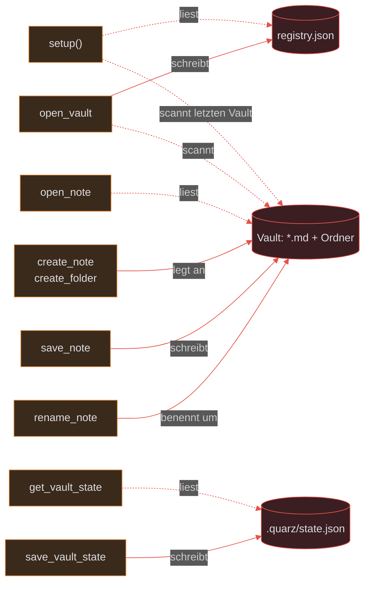
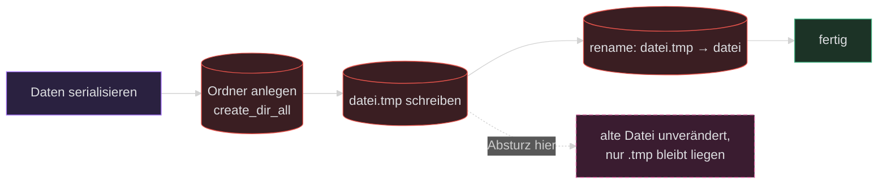

# Persistenz

[← Übersicht](README.md)

Das Backend schreibt vier Arten von Dateien. Alles andere lebt nur im RAM und wird beim Start neu aufgebaut.

| Datei | Ort | Inhalt | Geschrieben von |
|---|---|---|---|
| Notizen `*.md` | Vault-Ordner | Text der Notizen | `create_note`, `save_note`, `rename_note` |
| `registry.json` | App-Datenordner | bekannte Vaults, zuletzt geöffneter | `open_vault` |
| `state.json` | `<Vault>/.quarz/` | offene Tabs, fokussierte Notiz | `save_vault_state` |
| `quarz-editor.log` | Log-Ordner der App | Fehler und Infos | Logger, siehe [Fehler und Logging](fehler-und-logging.md) |

## Wer liest und schreibt was

Gestrichelt = lesen, durchgezogen = schreiben.



## Pfade

Der App-Datenordner kommt von Tauris `app_local_data_dir()`, der Log-Ordner von `app_log_dir()`. Beide hängen den Identifier `com.kelchninja.quarz` an:

| OS | `registry.json` | Logdatei |
|---|---|---|
| Windows | `%LOCALAPPDATA%\com.kelchninja.quarz\registry.json` | `%LOCALAPPDATA%\com.kelchninja.quarz\logs\quarz-editor.log` |
| macOS | `~/Library/Application Support/com.kelchninja.quarz/registry.json` | `~/Library/Logs/com.kelchninja.quarz/quarz-editor.log` |
| Linux | `~/.local/share/com.kelchninja.quarz/registry.json` | `~/.local/share/com.kelchninja.quarz/logs/quarz-editor.log` |

`registry.json` liegt bewusst im **lokalen** Ordner: Die absoluten Vault-Pfade gelten nur auf diesem Rechner.

## registry.json

```json
{
  "last_opened": "5f0c2a8e-3b1d-4c7a-9e2f-8a6b1d0c4e77",
  "vaults": [
    {
      "id": "5f0c2a8e-3b1d-4c7a-9e2f-8a6b1d0c4e77",
      "path": "D:\\Notizen",
      "name": "Notizen"
    }
  ]
}
```

| Feld | Bedeutung |
|---|---|
| `last_opened` | `id` des zuletzt geöffneten Vaults, `null` vor dem ersten Öffnen |
| `vaults[].id` | UUID v4, wird einmal beim ersten Öffnen vergeben |
| `vaults[].path` | absoluter Pfad zum Vault-Ordner |
| `vaults[].name` | Ordnername |

Das Feld `path` von `VaultRegistry` selbst (also wo die Datei liegt) ist `#[serde(skip)]` und steht nicht in der Datei. Die Feldnamen sind snake_case, denn die Registry geht nie ans Frontend.

**Lebenszyklus:**
1. `setup()`: `load(path)` bzw. `empty(path)` bei einem Fehler, die Registry merkt sich ihren Pfad.
2. `open_vault`: `remember(root)` sucht den Eintrag mit diesem Pfad oder legt einen neuen an und setzt `last_opened`. Danach schreibt `save()` die Datei.
3. Einträge werden nie entfernt, auch nicht, wenn der Ordner nicht mehr existiert.

## .quarz/state.json

```json
{
  "openNotes": ["Ideen.md", "projekte/quarz.md"],
  "lastFocusedNote": "projekte/quarz.md"
}
```

| Feld | Bedeutung |
|---|---|
| `openNotes` | offene Tabs in Tab-Reihenfolge, als `VaultPath` |
| `lastFocusedNote` | aktiver Tab, `null`, wenn keiner offen war |

- camelCase per `serde(rename_all)`, weil derselbe Typ auch ans Frontend geht.
- `#[serde(default)]` auf dem Struct: Fehlt ein Feld (alte Datei, neues Feld), wird es mit dem Standardwert gefüllt, statt den ganzen State zu verwerfen.
- Ein ungültiger Pfad in `openNotes` (z.B. `../x.md`) lässt das Parsen scheitern. Dann wird der Fehler geloggt und der State ist leer.
- Liegt **im** Vault, ist also an den Vault gebunden. Synchronisiert man den Vault per Git, sollte `.quarz/` in die `.gitignore`.

## Atomares Schreiben

`save_note`, `VaultRegistry::save` und `VaultState::save` schreiben nie direkt in die Zieldatei:



Ein Umbenennen auf demselben Laufwerk passiert in einem Schritt. Die Zieldatei ist also entweder ganz alt oder ganz neu, nie halb geschrieben.

| | Temp-Datei | legt Ordner an |
|---|---|---|
| `save_note` | `Notiz.md.tmp` | nein, der Ordner existiert ja |
| `VaultRegistry::save` | `registry.json.tmp` | ja |
| `VaultState::save` | `.quarz/state.json.tmp` | ja |

## Fehlende oder kaputte Dateien

| Datei | fehlt | kaputt |
|---|---|---|
| `registry.json` | leere Registry, normaler erster Start | geloggt, leere Registry, wird beim nächsten `open_vault` überschrieben |
| `state.json` | leerer State, keine Tabs | geloggt, leerer State, wird bei der nächsten Tab-Änderung überschrieben |
| Notiz aus `state.json` | Tab wird per `retain_existing` weggelassen | – |
| Vault-Ordner aus der Registry | geloggt, Picker | – |
