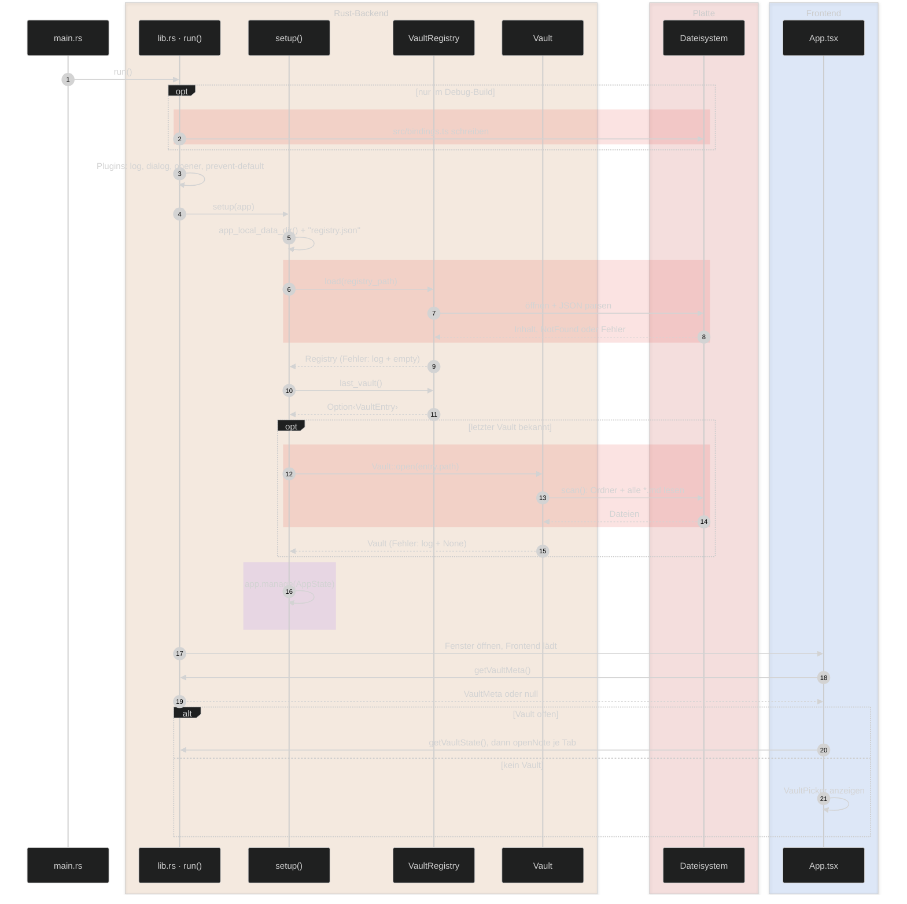
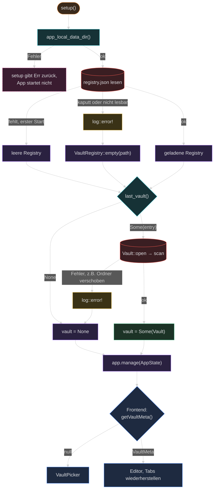

# App-Start

[← Übersicht](README.md)

Der Start entscheidet, ob der Nutzer direkt im zuletzt geöffneten Vault landet oder den Vault-Picker sieht. Der Code steht in `lib.rs` → `run()` → `setup()`.

## Ablauf

Die Plugins werden **vor** `setup()` initialisiert. Deshalb funktioniert `log::error!` schon im `setup`.

## Entscheidungen beim Start

| Situation | Ergebnis |
|---|---|
| Erster Start, `registry.json` fehlt | leere Registry → Picker. Die Datei entsteht beim ersten `open_vault`. |
| `registry.json` kaputt | Fehler im Log, leere Registry → Picker. Beim nächsten `open_vault` wird die Datei überschrieben. |
| Letzter Vault existiert nicht mehr | Fehler im Log, `vault = None` → Picker. Der alte Eintrag bleibt in der Registry. |
| Alles da | Vault ist sofort offen, das Frontend stellt die Tabs aus `.quarz/state.json` wieder her. |
| App-Datenordner nicht bestimmbar | `setup` schlägt fehl, die App startet nicht. Kommt praktisch nicht vor. |

## Bindings

Im Debug-Build schreibt `run()` bei **jedem Start** `src/bindings.ts` neu, mit allen Commands und den Typen, die `#[derive(specta::Type)]` haben. Wer einen Command oder Typ ändert, startet einfach `npm run tauri dev`. Im Release-Build passiert das nicht.
