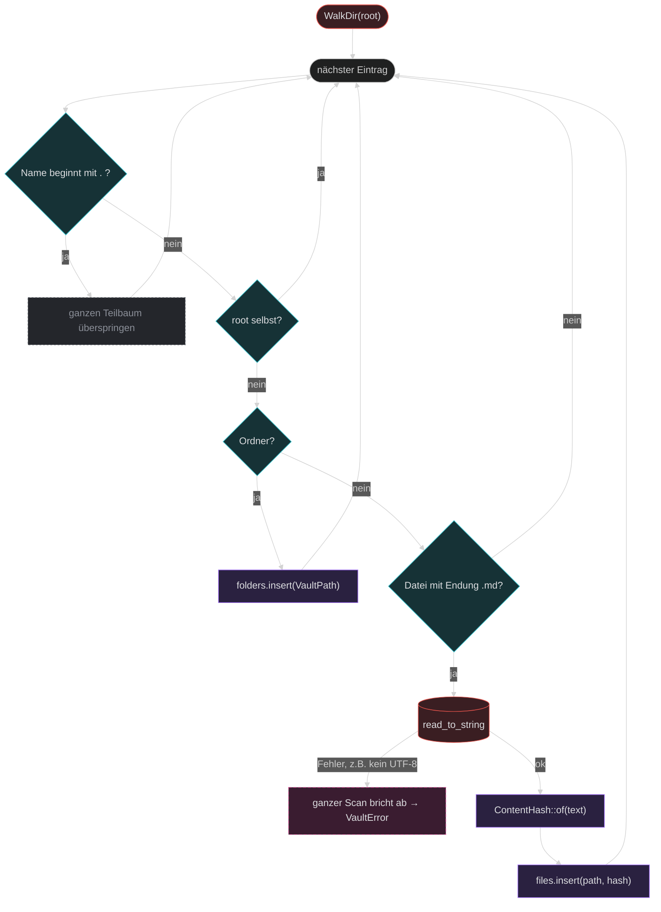
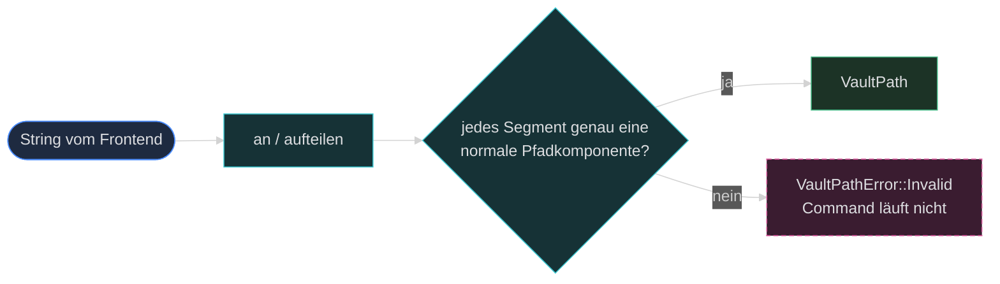

# Vault

[← Übersicht](README.md)

Ein Vault ist ein normaler Ordner mit Markdown-Dateien. `Vault` in `vault/vault.rs` ist sein **Index im RAM**: Er weiß, welche Notizen und Ordner es gibt, aber er hält keine Inhalte.

```rust
pub struct Vault {
    pub root: PathBuf,                              // absoluter Pfad zum Ordner
    pub files: BTreeMap<VaultPath, ContentHash>,    // jede .md-Datei → Hash ihres Inhalts
    pub folders: BTreeSet<VaultPath>,               // alle Ordner, auch leere
}
```

## Platte und Index


Der Index wird **nur beim Öffnen** aufgebaut und danach von den Commands selbst gepflegt. Es gibt keinen File-Watcher: Was außerhalb der App geändert wird, sieht die App erst beim nächsten Öffnen des Vaults.

## Scan

`Vault::open(root)` ruft `scan(root)` auf, das den Ordner rekursiv mit `walkdir` durchläuft.



- **Versteckte Einträge** (Name beginnt mit `.`) werden samt Inhalt übersprungen, also auch `.quarz/`, `.git/` und `.obsidian/`.
- **Jede** `.md`-Datei wird komplett gelesen, um ihren Hash zu berechnen. Das kostet bei großen Vaults die meiste Zeit.
- Kann eine einzige Datei nicht gelesen werden, schlägt das **ganze** Öffnen fehl.

## VaultPath

`VaultPath` (`vault/path.rs`) ist ein Pfad **relativ zum Vault-Root**, immer mit `/` getrennt und immer UTF-8, zum Beispiel `projekte/quarz.md`. Jeder Pfad, der zwischen Frontend und Backend wandert, hat diesen Typ.

Ein `VaultPath` kann den Vault nie verlassen, denn ungültige Werte lassen sich gar nicht erst bauen. Das Deserialisieren läuft über `TryFrom<String>` (`#[serde(try_from = "String")]`). Ein manipulierter Pfad aus dem Frontend scheitert also schon, bevor der Command läuft.



| Eingabe | Ergebnis | Grund |
|---|---|---|
| `a/b.md` | ✅ | |
| `Bücher/Notiz mit Leerzeichen.md` | ✅ | Umlaute und Leerzeichen sind erlaubt |
| `""` | ❌ | leeres Segment |
| `/abs.md` | ❌ | leeres erstes Segment |
| `../x.md`, `a/../b.md`, `./a.md` | ❌ | `.` und `..` sind keine normalen Komponenten |
| `a//b.md`, `a/` | ❌ | leeres Segment |
| `C:`, `a\b` (Windows) | ❌ | Laufwerk bzw. zwei Komponenten in einem Segment |

| Methode | Wofür |
|---|---|
| `try_from(String)` | prüfen und bauen, auch beim Deserialisieren |
| `from_absolute(root, abs)` | absoluten Pfad aus dem Scan in einen `VaultPath` umwandeln. Fehler: `OutsideVault`, `NotUtf8` |
| `to_absolute(root)` | zurück in einen `PathBuf`, segmentweise per `push`, damit unter Windows `\` entsteht. Nur direkt vor `std::fs`-Aufrufen benutzen |
| `as_str()` | der rohe String |

Die Regeln sind in `path.rs` mit Unit-Tests abgedeckt (`cargo test`).

## Dateioperationen

| Methode | Prüft vorher | Plattenzugriff | Index danach |
|---|---|---|---|
| `open(root)` | – | 🔴 `scan`: alles lesen | neu aufgebaut |
| `load(path)` | – | 🔴 `read_to_string` | unverändert |
| `create_note(path)` | endet auf `.md` | 🔴 `File::create_new` (Fehler, wenn vorhanden) | `files += path → Hash("")` |
| `create_folder(path)` | – | 🔴 `create_dir` (Elternordner muss existieren) | `folders += path` |
| `save_note(content, path)` | Notiz im Index | 🔴 `write(.md.tmp)` + `rename` | Hash aktualisiert |
| `rename_note(name, path)` | siehe [Commands → rename_note](commands.md#rename_note) | 🔴 `rename` | alter Pfad raus, neuer rein |

Löschen sowie Umbenennen oder Verschieben von Ordnern gibt es noch nicht.

## ContentHash

BLAKE3-Hash (32 Byte) des Notizinhalts. Er wird beim Scan berechnet und bei `create_note` und `save_note` aktualisiert. **Ausgewertet wird er noch nirgends.** Gedacht ist er, um später Änderungen von außen zu erkennen.

## VaultError

| Variante | Wann |
|---|---|
| `NotFound(path)` | `save_note` / `rename_note`: Notiz nicht im Index |
| `NotMarkdown(path)` | `create_note` / `rename_note`: Pfad endet nicht auf `.md` |
| `NotAllowed(name)` | `rename_note`: Name leer, mit `/` oder ergibt keinen gültigen Pfad |
| `AlreadyExists(path)` | `rename_note`: Ziel existiert schon |
| `Path(VaultPathError)` | Scan: Pfad außerhalb des Vaults oder nicht UTF-8 |
| `Io(io::Error)` | jeder Fehler aus `std::fs`, per `#[from]` und `?` |

## Bekannte Einschränkungen

- Eine einzige unlesbare `.md`-Datei (z.B. nicht UTF-8) verhindert das Öffnen des ganzen Vaults.
- Keine Erkennung von Änderungen außerhalb der App, solange der Vault offen ist.
- Symlinks werden nicht aufgelöst. `root` und gescannte Pfade müssen gleich aufgebaut sein.
- `open_note` liest auch Dateien, die nicht im Index stehen, solange es sie auf der Platte gibt.
