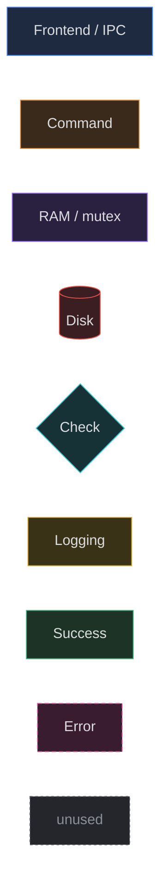
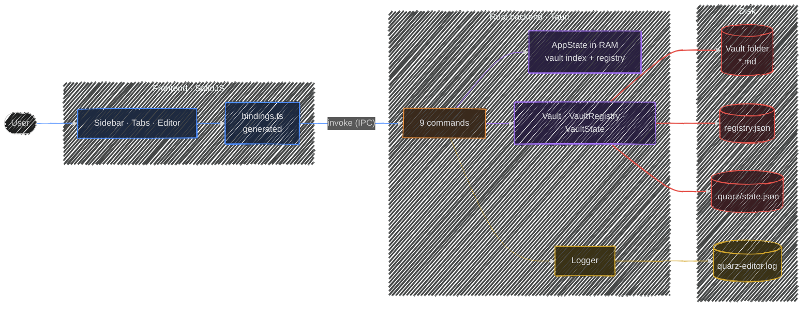
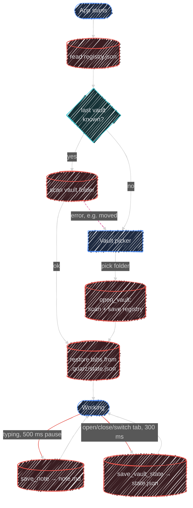
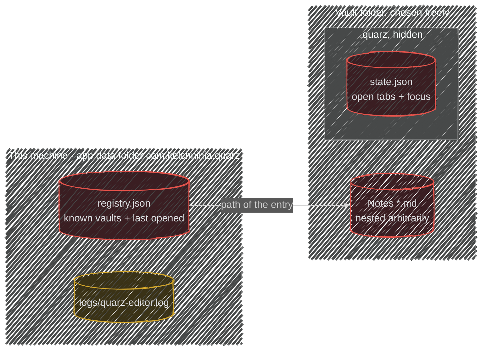

# Quarz – Rust Backend

[🇩🇪 Deutsch](../de/README.md) · 🇬🇧 English

Documentation of the backend in `src-tauri/` (Tauri 2, Rust 2024).
State: version 0.1.0, November 2026.

The backend can:

- open a **vault** (a folder of Markdown notes) and index it in RAM,
- **read, create, save and rename** notes, and create folders,
- remember **which vault was open last** (`registry.json`),
- store the **open tabs** per vault (`.quarz/state.json`),
- write errors to a **log file**.

The frontend (SolidJS) talks to the backend exclusively through **Tauri commands**.

## Contents

| Page | What it covers |
|---|---|
| [Architecture](architecture.md) | Layers, modules, `AppState`, data model |
| [Startup](startup.md) | What happens at startup, which vault opens |
| [Commands](commands.md) | The IPC interface to the frontend, all 9 commands |
| [Vault](vault.md) | Index in RAM, scan, `VaultPath`, file operations |
| [Persistence](persistence.md) | Which files live where and how they are written |
| [Errors and logging](errors-and-logging.md) | Error types and the path of an error into the log |

The PlantUML diagrams in [`docs/diagrams/`](../../diagrams/) show an earlier state.

## Color legend

All diagrams use the same colors:

| Color | Meaning |
|---|---|
| 🔵 Blue | Frontend, IPC calls |
| 🟠 Orange | Commands, i.e. the entry into the backend |
| 🟣 Purple | State in RAM: `AppState`, mutex, vault index |
| 🔴 Red | **Disk access** (`std::fs`) |
| 🩵 Teal | Check, validation, decision |
| 🟡 Yellow | Logging |
| 🟢 Green | Success |
| 🩷 Pink, dashed | Error path |
| ⚪ Gray, dashed | Unused or ignored |



## The program in sketches

### Sketch 1: Who talks to whom



### Sketch 2: A session from startup to work



### Sketch 3: Where the data lives



## Module overview

```
src-tauri/src/
├── main.rs              entry point, calls lib::run()
├── lib.rs               Tauri builder: plugins, setup(), commands, bindings export
├── app.rs               AppState: Mutex<Option<Vault>> + Mutex<VaultRegistry>
├── commands/
│   ├── vault.rs         all 9 Tauri commands
│   └── helper.rs        with_vault / with_registry (lock + access)
├── config/
│   ├── vaultregistry.rs VaultRegistry: load/save registry.json
│   └── vaultentry.rs    VaultEntry: id, path, name
├── logging/
│   └── logging.rs       log_err: log an error and turn it into a String
└── vault/
    ├── vault.rs         Vault: index, scan, file operations, VaultError
    ├── path.rs          VaultPath: validated, relative path
    ├── meta.rs          VaultMeta / NoteMeta: view for the frontend
    ├── vaultstate.rs    VaultState: .quarz/state.json
    ├── note.rs          ContentHash (+ unused: Note, NoteDocument)
    ├── entry.rs         unused: EntryMeta, Editable
    └── folder.rs        unused: Folder
```

## Dependencies

| Crate | Purpose |
|---|---|
| `tauri` 2 | App framework, windows, IPC, paths |
| `tauri-specta`, `specta`, `specta-typescript` | generate `src/bindings.ts` from the commands and types |
| `serde`, `serde_json` | JSON for IPC, `registry.json`, `state.json` |
| `thiserror` | error enums with messages |
| `walkdir` | recursive scan of the vault folder |
| `blake3` | `ContentHash` of a note |
| `uuid` | IDs of the vault entries in the registry |
| `log`, `tauri-plugin-log` | logging to the terminal and to a file |
| `tauri-plugin-dialog` | folder selection in the vault picker (used by the frontend) |
| `tauri-plugin-prevent-default` | suppresses browser shortcuts in the webview |
| `tauri-plugin-opener` | **unused**, left over from the template |
