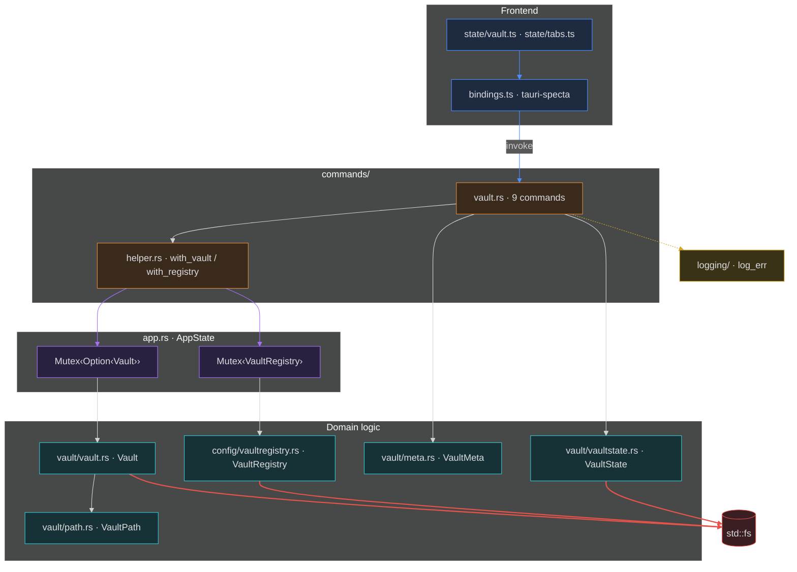
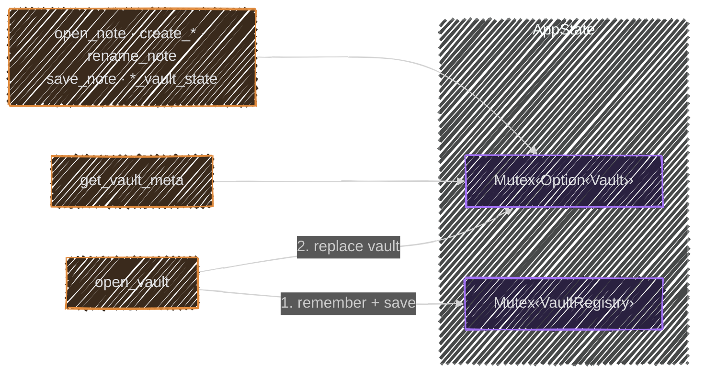
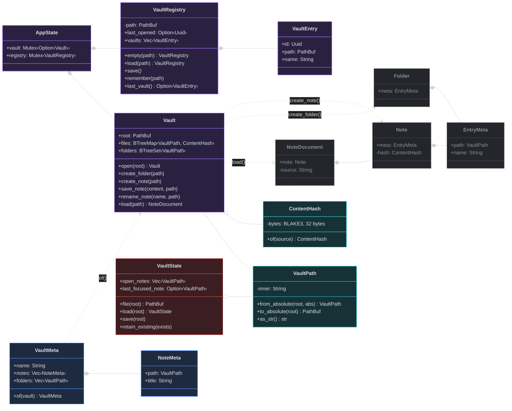

# Architecture

[← Overview](README.md)

## Layers

A call from the frontend always takes the same route: generated function in `bindings.ts` → command → helper with lock → domain logic → file system.



| Layer | Job | Knows nothing about |
|---|---|---|
| `commands/` | accepts IPC calls, takes the lock, turns errors into `String` and logs them | file formats |
| `app.rs` | holds the shared state behind mutexes | logic |
| `vault/`, `config/` | domain logic and file access | Tauri, IPC, locks |
| `logging/` | `log_err`: log an error and pass it on as `String` | – |

`Vault`, `VaultRegistry` and `VaultState` don't know Tauri. Only `setup()` in `lib.rs` determines the path of the registry; after that the registry remembers it itself.

## AppState

```rust
pub struct AppState {
    pub vault: Mutex<Option<Vault>>,     // None = no vault open → picker
    pub registry: Mutex<VaultRegistry>,  // known vaults, last opened
}
```

- Registered once in `setup()` with `app.manage(...)`. Commands receive it as `tauri::State<'_, AppState>`.
- `VaultState` is **not** part of `AppState`. It is read from or written to the file directly when needed; the source of truth for open tabs is the frontend.
- No command holds both locks at once. `open_vault` locks the registry first, releases it, then locks the vault. This rules out deadlocks.



### Concurrency

All commands are `async` and run on Tauri's thread pool. The `std::sync::Mutex` is held for the **whole** operation, including disk access. Commands on the same vault therefore run one after another, never at the same time. With the current load (one save every few hundred milliseconds) this is not a problem.

The only exception: `open_vault` scans the new folder **without** a lock. Only then is the finished `Vault` put in place.

## Data model

Gray dashed: types that exist but are no longer used.



### What the frontend sees

Only these types cross the IPC boundary. `specta` generates TypeScript types for them in `src/bindings.ts`:

| Rust | TypeScript | Note |
|---|---|---|
| `VaultPath` | `string` | validated on receipt, see [Vault](vault.md#vaultpath) |
| `VaultMeta` | `{ name; notes: NoteMeta[]; folders: VaultPath[] }` | full view of the vault, without contents |
| `NoteMeta` | `{ path; title }` | `title` = file name without `.md` |
| `VaultState` | `{ openNotes: VaultPath[]; lastFocusedNote: VaultPath \| null }` | camelCase via `serde(rename_all)` |
| `Result<T, String>` | `{ status: "ok", data: T } \| { status: "error", error: string }` | |

The sidebar builds its tree itself from `notes` and `folders` (`buildTree.ts`). The backend returns a flat list.

## Unused code

Reported as warnings by `cargo check` or found by searching:

| What | Where | Why unused |
|---|---|---|
| `Note`, `NoteDocument`, `EntryMeta`, `Folder`, trait `Editable` | `vault/note.rs`, `entry.rs`, `folder.rs` | commands discard the return values; of `NoteDocument` only the text is read |
| `ConfigDir`, `VaultNotFound`, `VaultAlreadyExists`, `InvalidVaultPath` | `config/vaultregistry.rs` | never constructed |
| `tauri-plugin-opener` | `Cargo.toml`, `lib.rs`, capabilities | the frontend doesn't import it |
