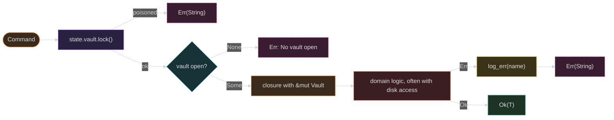
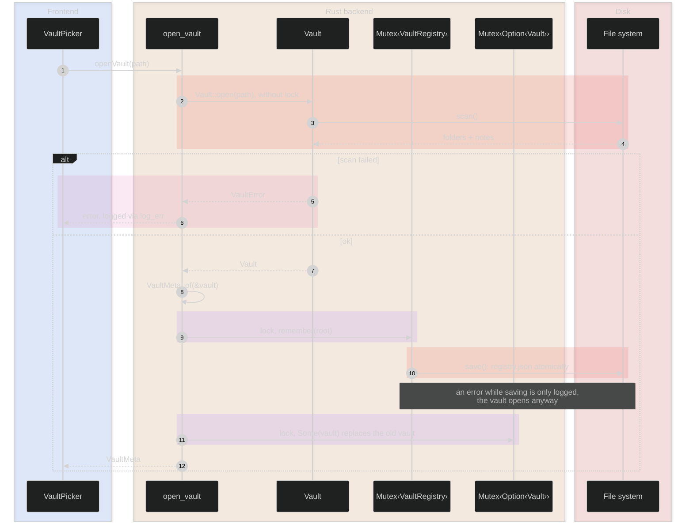
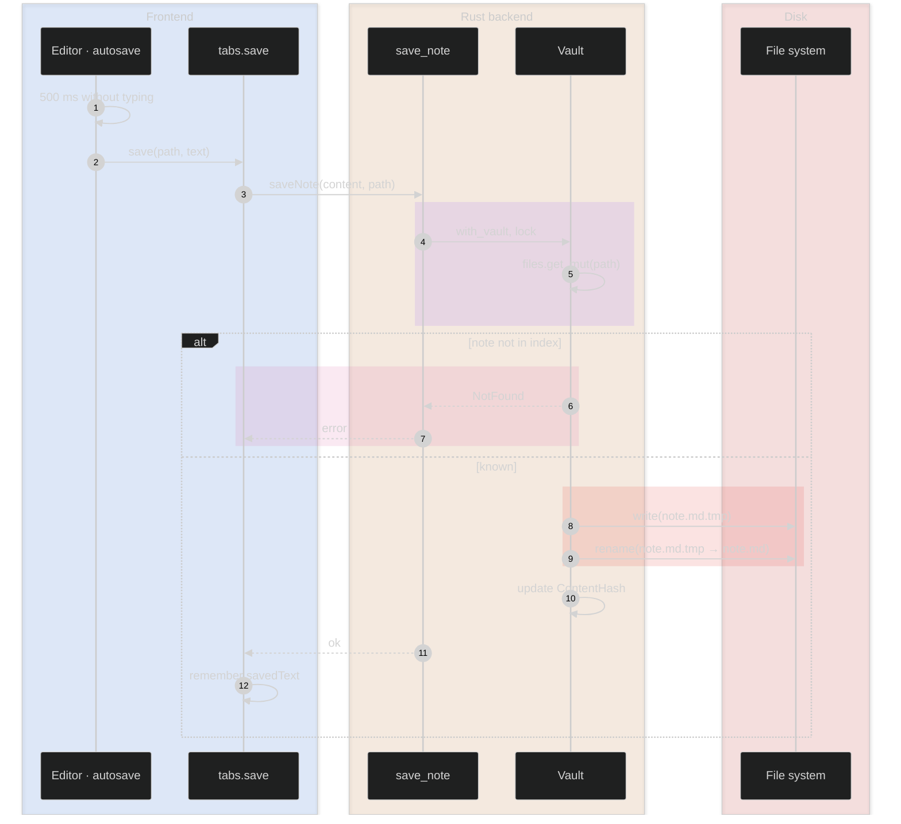
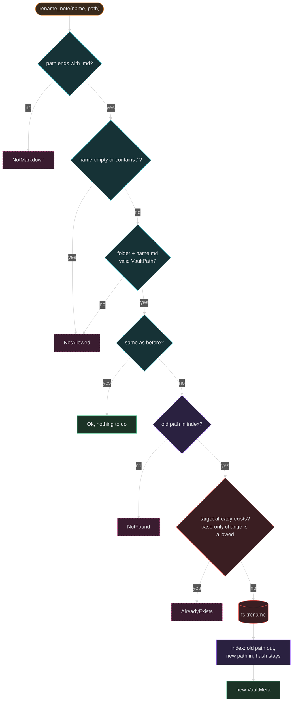
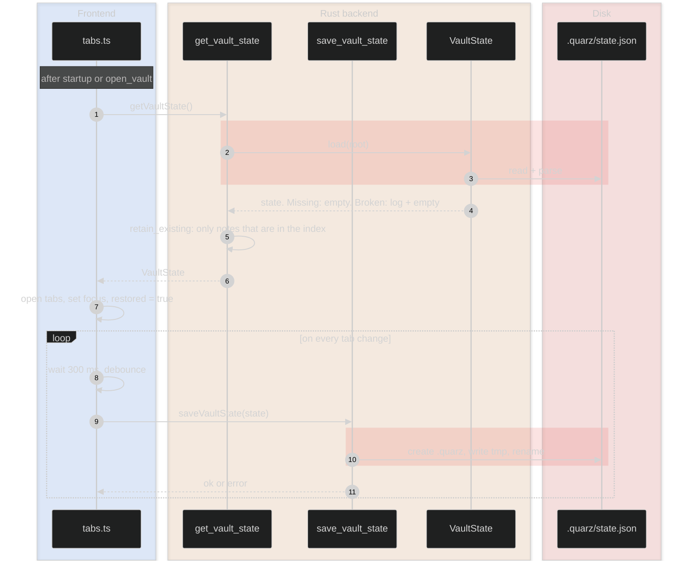

# Commands

[← Overview](README.md)

Commands are the only interface between frontend and backend. They all live in `commands/vault.rs` and are registered in `lib.rs` via `collect_commands!`. The frontend calls them through the generated functions in `src/bindings.ts`, for example `commands.saveNote(text, path)`.

## Overview

| Command | Parameters | Returns | Lock | Disk | Errors logged |
|---|---|---|---|---|---|
| `open_vault` | `path: String` | `VaultMeta` | registry, then vault | 🔴 scans the whole folder, writes `registry.json` | yes |
| `get_vault_meta` | – | `Option<VaultMeta>` | vault | – | no |
| `open_note` | `path: VaultPath` | `String` (content) | vault | 🔴 reads `.md` | yes |
| `create_note` | `path: VaultPath` | `VaultMeta` | vault | 🔴 creates an empty file | yes |
| `create_folder` | `path: VaultPath` | `VaultMeta` | vault | 🔴 creates a folder | yes |
| `rename_note` | `name: String`, `path: VaultPath` | `VaultMeta` | vault | 🔴 renames the file | yes |
| `save_note` | `content: String`, `path: VaultPath` | `()` | vault | 🔴 writes `.md` atomically | yes |
| `get_vault_state` | – | `VaultState` | vault | 🔴 reads `.quarz/state.json` | broken file: yes |
| `save_vault_state` | `vault_state: VaultState` | `()` | vault | 🔴 writes `.quarz/state.json` atomically | yes |

All commands return `Result<T, String>`. Commands that change the vault return the new `VaultMeta`, so the sidebar is up to date without a second call.

## Common pattern

Almost every command consists of `with_vault`, one call into the domain logic, and `log_err`:

```rust
pub async fn create_note(path: VaultPath, state: tauri::State<'_, AppState>) -> Result<VaultMeta, String> {
    helper::with_vault(&state, |vault| {
        vault.create_note(path).map_err(log_err("create_note"))?;
        Ok(VaultMeta::of(vault))
    })
}
```



| Helper | File | Does |
|---|---|---|
| `with_vault(state, f)` | `commands/helper.rs` | locks `state.vault`, returns `"No vault open"` if `None`, otherwise calls `f(&mut Vault)` |
| `with_registry(state, f)` | `commands/helper.rs` | locks `state.registry` and calls `f(&mut VaultRegistry)` |
| `log_err(context)` | `logging/logging.rs` | closure for `map_err`: logs `"{context}: {e}"` as an error and returns `e.to_string()` |

### Validated parameters

Parameters of type `VaultPath` are validated **during deserialization**, before the command even runs. A path like `../../etc/passwd` never reaches the command; the frontend gets an error right away. Details in [Vault → VaultPath](vault.md#vaultpath).

## open_vault

Opens a new vault from the picker and remembers it in the registry.



## save_note (autosave)

The frontend calls `save_note` 500 ms after the last keystroke, separately per note.



`save_note` does not create notes. A note that isn't in the index is rejected. The `.md.tmp` file doesn't end in `.md` and is therefore ignored by the scan if it is left behind after a crash.

## rename_note

Renames notes only, and only within their folder. `name` is the new name **without** `.md`.



The "target already exists" check is necessary because `fs::rename` would otherwise silently overwrite an existing file. The exception for case-only changes is needed on Windows: there, `note.md` already "exists" when you rename `Note.md` to `note.md`.

## get_vault_state / save_vault_state

Remember the open tabs per vault. The frontend is the source of truth; the backend only reads and writes the file.



`retain_existing` removes tabs of notes that were deleted outside the app. If the focused note was among them, the last remaining tab gets the focus.

## get_vault_meta / open_note / create_note / create_folder

| Command | Flow |
|---|---|
| `get_vault_meta` | lock, `VaultMeta::of(vault)`, or `None` if no vault is open. No disk access; the frontend calls it at startup. |
| `open_note` | `fs::read_to_string` of the file, returns the text. **Not** in the index? Still read, as long as the file exists. |
| `create_note` | path must end in `.md`, `File::create_new` (fails if the file already exists), hash of the empty text into the index. The frontend picks the free name ("Unbenannt 1.md"). |
| `create_folder` | `fs::create_dir` (parent folder must exist), path into `folders`. |
