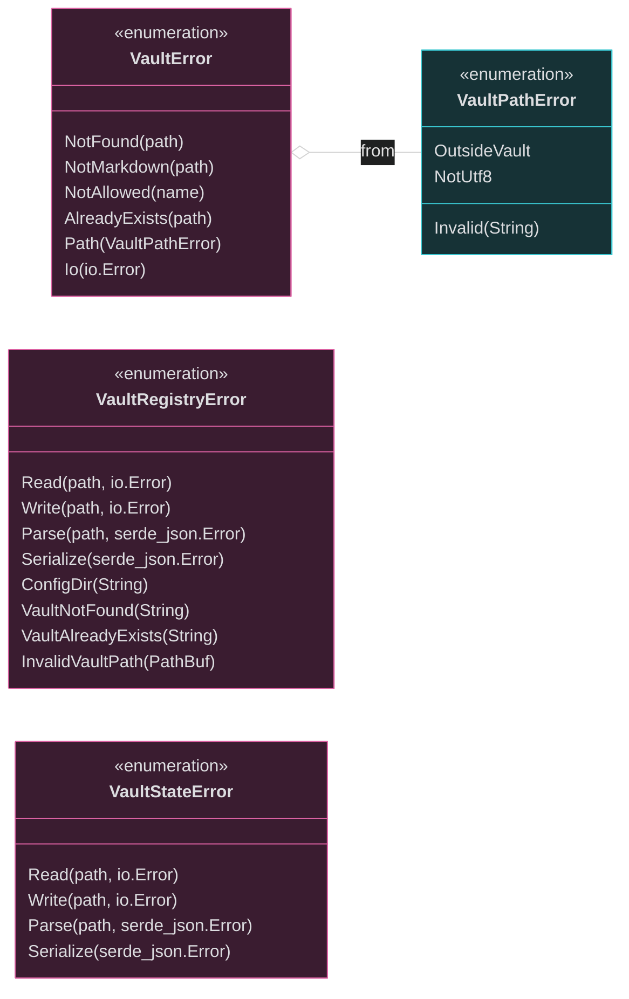
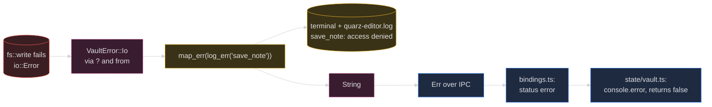
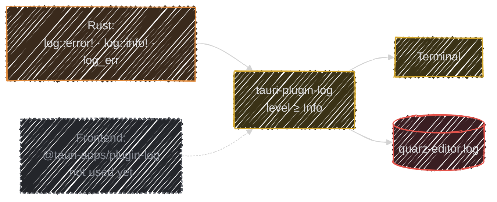

# Errors and logging

[← Overview](README.md)

## Error types

Every module has its own error enum built with `thiserror`. Only a `String` ever crosses the IPC boundary.



| Enum | File | Notable |
|---|---|---|
| `VaultError` | `vault/vault.rs` | `Io` and `Path` via `#[from]`, so `?` is enough |
| `VaultPathError` | `vault/path.rs` | raised when constructing a `VaultPath`, also during deserialization |
| `VaultRegistryError` | `config/vaultregistry.rs` | `Read`/`Write`/`Parse` carry the path, set via `map_err`. The last four variants are unused |
| `VaultStateError` | `vault/vaultstate.rs` | built the same way as `VaultRegistryError` |

`Read` and `Write` have the same source type (`io::Error`). That's why the variant is chosen with `map_err` instead of `#[from]`: `#[from]` can only point to one variant per source type.

## Path of an error

Example: `save_note` fails because the file is read-only.



`log_err` is a small factory for `map_err` closures:

```rust
pub fn log_err<E: std::fmt::Display>(context: &str) -> impl FnOnce(E) -> String + '_ {
    move |e| {
        log::error!("{context}: {e}");
        e.to_string()
    }
}
```

This way every error is logged **exactly once**, namely in Rust, where the real error and its path are known. The `console.error` in the frontend only shows up in the DevTools.

## Where errors are handled

| Location | Error | Reaction |
|---|---|---|
| `setup`: `app_local_data_dir()` | path cannot be determined | `?`, app does not start |
| `setup`: `VaultRegistry::load` | file broken or unreadable | `log::error!`, empty registry |
| `setup`: `Vault::open` | last vault missing or unreadable | `log::error!`, `vault = None` → picker |
| `open_vault`: `registry.save()` | registry not writable | `log::error!`, vault opens anyway |
| `get_vault_state`: `VaultState::load` | `state.json` broken | `log::error!`, empty state |
| all commands: domain logic | `VaultError`, `VaultStateError` | `log_err`, error to the frontend |
| all commands: `lock()` | mutex poisoned (panic in another command) | `to_string`, **not** logged |
| `with_vault` | no vault open | `"No vault open"`, not logged |
| deserializing a `VaultPath` | invalid path | Tauri rejects the call, the command does not run |

Principle: if the app can reasonably continue, the error is logged and a fallback value is used. The app should never become unusable because of a broken auxiliary file.

## Logging

Set up in `lib.rs` with `tauri-plugin-log`:

```rust
tauri_plugin_log::Builder::new()
    .targets([
        Target::new(TargetKind::Stdout),                     // terminal of tauri dev
        Target::new(TargetKind::LogDir { file_name: None }), // file, name = productName
    ])
    .level(log::LevelFilter::Info)
    .build()
```



| Property | Value |
|---|---|
| Level | `Info` and above. `debug!`/`trace!` are discarded |
| Targets | terminal (only visible with `tauri dev`) and file, paths in [Persistence → Paths](persistence.md#paths) |
| Rotation | none, the file grows without limit |
| Frontend | the `log:default` permission and the npm package are present; the frontend still uses `console.error` |
| Panics | are not logged. Release builds use `panic = "abort"`, so the app exits without an entry |

Note contents never go into the log, only paths.
