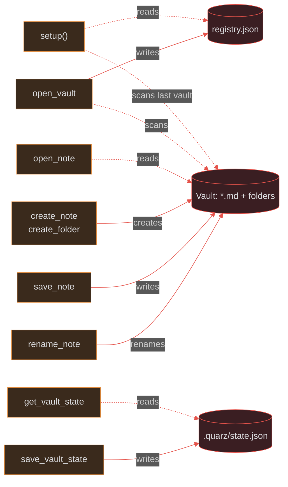
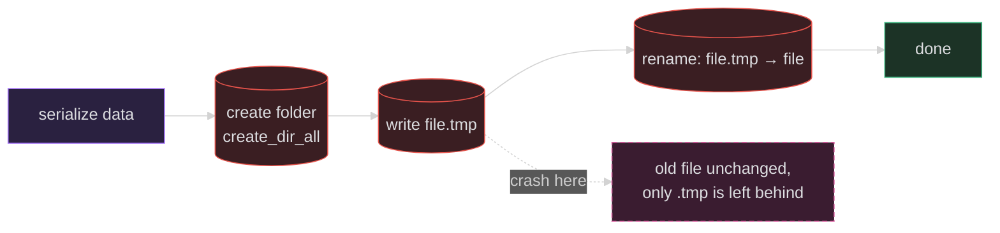

# Persistence

[← Overview](README.md)

The backend writes four kinds of files. Everything else lives in RAM only and is rebuilt at startup.

| File | Location | Content | Written by |
|---|---|---|---|
| Notes `*.md` | vault folder | text of the notes | `create_note`, `save_note`, `rename_note` |
| `registry.json` | app data folder | known vaults, last opened one | `open_vault` |
| `state.json` | `<vault>/.quarz/` | open tabs, focused note | `save_vault_state` |
| `quarz-editor.log` | app log folder | errors and info | logger, see [Errors and logging](errors-and-logging.md) |

## Who reads and writes what

Dashed = read, solid = write.



## Paths

The app data folder comes from Tauri's `app_local_data_dir()`, the log folder from `app_log_dir()`. Both append the identifier `com.kelchninja.quarz`:

| OS | `registry.json` | Log file |
|---|---|---|
| Windows | `%LOCALAPPDATA%\com.kelchninja.quarz\registry.json` | `%LOCALAPPDATA%\com.kelchninja.quarz\logs\quarz-editor.log` |
| macOS | `~/Library/Application Support/com.kelchninja.quarz/registry.json` | `~/Library/Logs/com.kelchninja.quarz/quarz-editor.log` |
| Linux | `~/.local/share/com.kelchninja.quarz/registry.json` | `~/.local/share/com.kelchninja.quarz/logs/quarz-editor.log` |

`registry.json` deliberately lives in the **local** folder: the absolute vault paths are only valid on this machine.

## registry.json

```json
{
  "last_opened": "5f0c2a8e-3b1d-4c7a-9e2f-8a6b1d0c4e77",
  "vaults": [
    {
      "id": "5f0c2a8e-3b1d-4c7a-9e2f-8a6b1d0c4e77",
      "path": "D:\\Notes",
      "name": "Notes"
    }
  ]
}
```

| Field | Meaning |
|---|---|
| `last_opened` | `id` of the vault opened last, `null` before the first open |
| `vaults[].id` | UUID v4, assigned once on the first open |
| `vaults[].path` | absolute path to the vault folder |
| `vaults[].name` | folder name |

The `path` field of `VaultRegistry` itself (i.e. where the file lives) is `#[serde(skip)]` and is not in the file. Field names are snake_case, because the registry never goes to the frontend.

**Lifecycle:**
1. `setup()`: `load(path)`, or `empty(path)` on error; the registry remembers its path.
2. `open_vault`: `remember(root)` finds the entry with this path or creates a new one and sets `last_opened`. Then `save()` writes the file.
3. Entries are never removed, not even when the folder no longer exists.

## .quarz/state.json

```json
{
  "openNotes": ["Ideas.md", "projects/quarz.md"],
  "lastFocusedNote": "projects/quarz.md"
}
```

| Field | Meaning |
|---|---|
| `openNotes` | open tabs in tab order, as `VaultPath` |
| `lastFocusedNote` | active tab, `null` if none was open |

- camelCase via `serde(rename_all)`, because the same type also goes to the frontend.
- `#[serde(default)]` on the struct: if a field is missing (old file, new field), it is filled with the default value instead of discarding the whole state.
- An invalid path in `openNotes` (e.g. `../x.md`) makes parsing fail. The error is then logged and the state is empty.
- Lives **inside** the vault, so it is tied to the vault. If you sync the vault via Git, `.quarz/` should go into `.gitignore`.

## Atomic writes

`save_note`, `VaultRegistry::save` and `VaultState::save` never write directly to the target file:



A rename on the same drive happens in one step. The target file is therefore either entirely old or entirely new, never half written.

| | Temp file | creates folder |
|---|---|---|
| `save_note` | `note.md.tmp` | no, the folder already exists |
| `VaultRegistry::save` | `registry.json.tmp` | yes |
| `VaultState::save` | `.quarz/state.json.tmp` | yes |

## Missing or broken files

| File | missing | broken |
|---|---|---|
| `registry.json` | empty registry, normal first start | logged, empty registry, overwritten on the next `open_vault` |
| `state.json` | empty state, no tabs | logged, empty state, overwritten on the next tab change |
| Note from `state.json` | tab is dropped via `retain_existing` | – |
| Vault folder from the registry | logged, picker | – |
