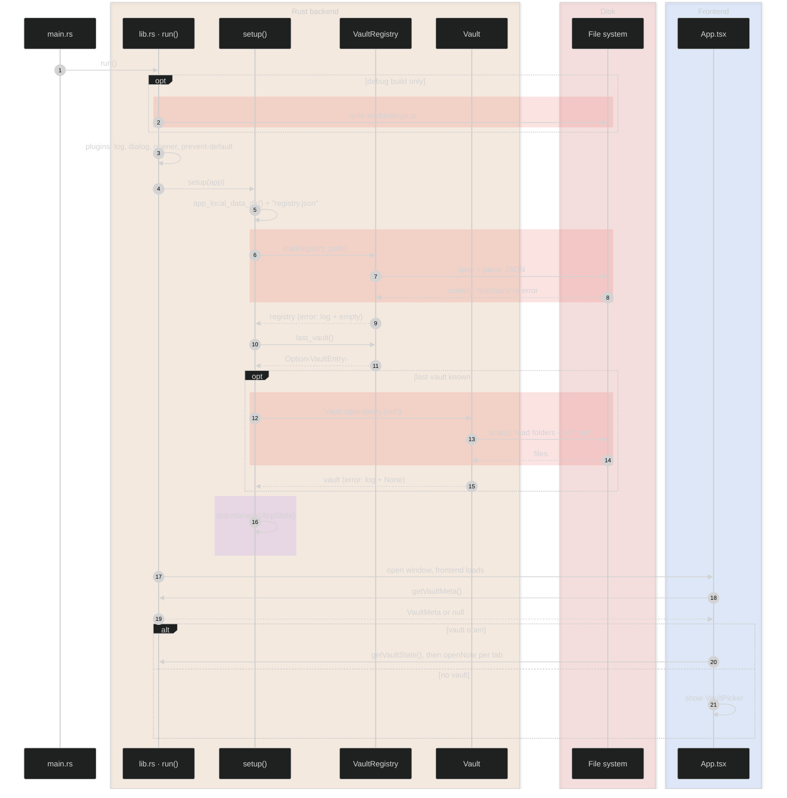
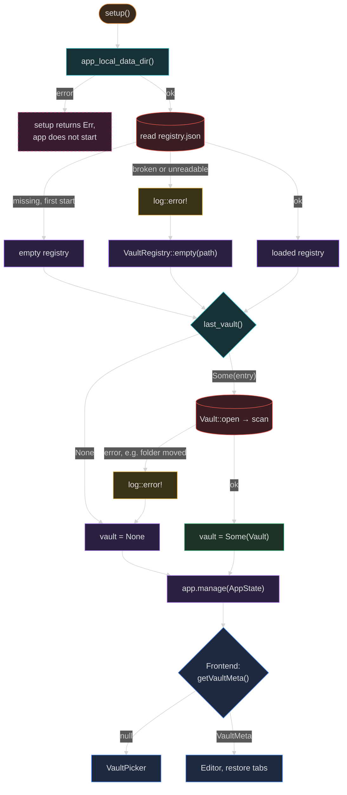

# Startup

[← Overview](README.md)

Startup decides whether the user lands directly in the vault opened last or sees the vault picker. The code lives in `lib.rs` → `run()` → `setup()`.

## Flow

Plugins are initialized **before** `setup()`. That's why `log::error!` already works in `setup`.

## Decisions at startup

| Situation | Result |
|---|---|
| First start, `registry.json` missing | empty registry → picker. The file is created on the first `open_vault`. |
| `registry.json` broken | error in the log, empty registry → picker. The file is overwritten on the next `open_vault`. |
| Last vault no longer exists | error in the log, `vault = None` → picker. The old entry stays in the registry. |
| Everything present | the vault is open right away, the frontend restores the tabs from `.quarz/state.json`. |
| App data folder cannot be determined | `setup` fails, the app does not start. Practically never happens. |

## Bindings

In a debug build, `run()` rewrites `src/bindings.ts` on **every start**, with all commands and the types that have `#[derive(specta::Type)]`. After changing a command or type, simply run `npm run tauri dev`. Release builds don't do this.
