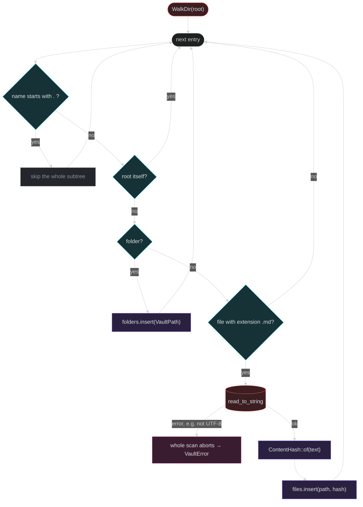
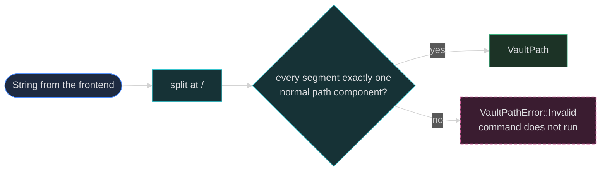

# Vault

[← Overview](README.md)

A vault is a normal folder of Markdown files. `Vault` in `vault/vault.rs` is its **index in RAM**: it knows which notes and folders exist, but holds no contents.

```rust
pub struct Vault {
    pub root: PathBuf,                              // absolute path to the folder
    pub files: BTreeMap<VaultPath, ContentHash>,    // every .md file → hash of its content
    pub folders: BTreeSet<VaultPath>,               // all folders, including empty ones
}
```

## Disk and index


The index is built **only when opening** and maintained by the commands themselves afterwards. There is no file watcher: changes made outside the app are only seen the next time the vault is opened.

## Scan

`Vault::open(root)` calls `scan(root)`, which walks the folder recursively with `walkdir`.



- **Hidden entries** (name starts with `.`) are skipped including their contents, so `.quarz/`, `.git/` and `.obsidian/` too.
- **Every** `.md` file is read completely to compute its hash. This takes most of the time for large vaults.
- If a single file cannot be read, opening the **whole** vault fails.

## VaultPath

`VaultPath` (`vault/path.rs`) is a path **relative to the vault root**, always separated by `/` and always UTF-8, for example `projects/quarz.md`. Every path that travels between frontend and backend has this type.

A `VaultPath` can never leave the vault, because invalid values cannot be constructed at all. Deserialization goes through `TryFrom<String>` (`#[serde(try_from = "String")]`). A manipulated path from the frontend therefore fails before the command runs.



| Input | Result | Reason |
|---|---|---|
| `a/b.md` | ✅ | |
| `Bücher/Notiz mit Leerzeichen.md` | ✅ | umlauts and spaces are allowed |
| `""` | ❌ | empty segment |
| `/abs.md` | ❌ | empty first segment |
| `../x.md`, `a/../b.md`, `./a.md` | ❌ | `.` and `..` are not normal components |
| `a//b.md`, `a/` | ❌ | empty segment |
| `C:`, `a\b` (Windows) | ❌ | drive, or two components in one segment |

| Method | Purpose |
|---|---|
| `try_from(String)` | validate and construct, also during deserialization |
| `from_absolute(root, abs)` | turn an absolute path from the scan into a `VaultPath`. Errors: `OutsideVault`, `NotUtf8` |
| `to_absolute(root)` | back into a `PathBuf`, segment by segment via `push`, so Windows gets `\`. Only use directly before `std::fs` calls |
| `as_str()` | the raw string |

The rules are covered by unit tests in `path.rs` (`cargo test`).

## File operations

| Method | Checks first | Disk access | Index afterwards |
|---|---|---|---|
| `open(root)` | – | 🔴 `scan`: read everything | rebuilt |
| `load(path)` | – | 🔴 `read_to_string` | unchanged |
| `create_note(path)` | ends with `.md` | 🔴 `File::create_new` (error if it exists) | `files += path → hash("")` |
| `create_folder(path)` | – | 🔴 `create_dir` (parent folder must exist) | `folders += path` |
| `save_note(content, path)` | note in index | 🔴 `write(.md.tmp)` + `rename` | hash updated |
| `rename_note(name, path)` | see [Commands → rename_note](commands.md#rename_note) | 🔴 `rename` | old path out, new path in |

Deleting, and renaming or moving folders, doesn't exist yet.

## ContentHash

BLAKE3 hash (32 bytes) of the note content. It is computed during the scan and updated by `create_note` and `save_note`. **It is not evaluated anywhere yet.** The idea is to detect external changes later.

## VaultError

| Variant | When |
|---|---|
| `NotFound(path)` | `save_note` / `rename_note`: note not in the index |
| `NotMarkdown(path)` | `create_note` / `rename_note`: path doesn't end in `.md` |
| `NotAllowed(name)` | `rename_note`: name empty, contains `/` or doesn't produce a valid path |
| `AlreadyExists(path)` | `rename_note`: target already exists |
| `Path(VaultPathError)` | scan: path outside the vault or not UTF-8 |
| `Io(io::Error)` | any error from `std::fs`, via `#[from]` and `?` |

## Known limitations

- A single unreadable `.md` file (e.g. not UTF-8) prevents opening the whole vault.
- No detection of changes outside the app while the vault is open.
- Symlinks are not resolved. `root` and scanned paths must be built the same way.
- `open_note` also reads files that are not in the index, as long as they exist on disk.
